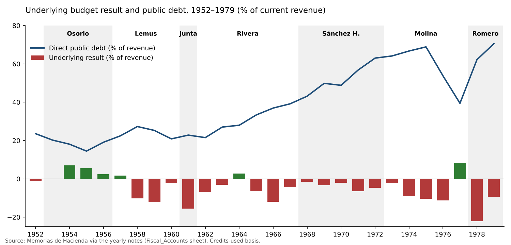
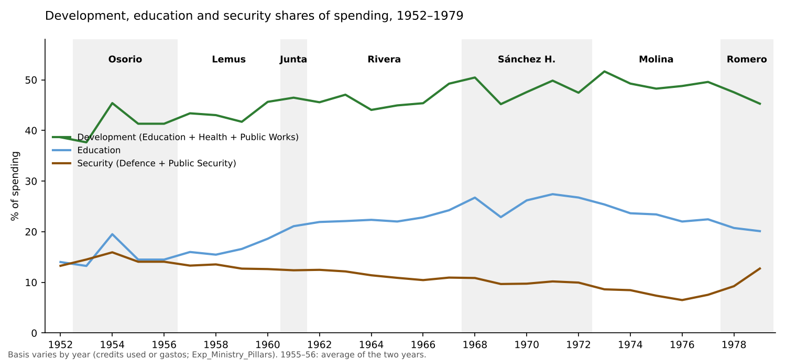

# The Combined Fiscal Accounts, 1952–1979: Expenditure, Interest and Debt — First Version and First Results

**Working note for discussion — 12 November 2026.** Companion to the workbook *El_Salvador_Fiscal_Accounts_Memorias_1952_1979.xlsx* (folder "Fiscal Accounts 1952-1979"). It is the first version of the building blocks agreed this morning:

- revenue, expenditure and interest on the debt in one workbook;
- credits used as the main basis, with gastos alongside;
- national analysis.

Everything is built from figures already verified in the yearly notes and the Spending Data files. **No new extraction yet;** the 1957–59 extraction is the next step.

---

## 1. What the workbook contains

The revenue sheets are kept unchanged and seven sheets are added.

| Sheet | Content | Coverage |
|:--|:--|:--|
| **Fiscal_Accounts** | Current revenue (linked), credits used, gastos, commitments; commitment-basis and underlying results; interest; primary result; amortization; gross financing need; direct public debt; Superávit Financiero; ratios | 1952–79 (interest and amortization with gaps) |
| **Exp_Ministry_Pillars** | Defensa, Seguridad Pública, Educación, Salud, Obras Públicas, Agricultura, Interior, other; security and development pillars; shares | 1952–79, one basis per year, marked |
| **Exp_Economic** | Wages, goods and services, interest, current transfers, real investment, financial investment, capital transfers, amortization | 1952–56, 1970–72, 1974–79 |
| **Periods_Fiscal** | The same governments as the revenue series | 1953–79 |
| **Analytics_Cycle** | Year-on-year changes classified by the coffee cycle (boom, bust, neutral), with a summary by phase | 1954–79 |
| **Charts_Fiscal** | Underlying result; interest and debt; spending shares; revenue against spending and the coffee duty | 1952–79 |

Every total ties to the figure printed in the Memoria, as cited in the notes. Where a basis changes between years (1955–57, 1964, 1967, 1970, 1973), the row is marked and left out of the year-on-year analytics.

---

## 2. First results

*All shares are of current revenue or of spending, as stated. Periods assign each year to the president inaugurated the previous July.*

### 2.1 Spending followed revenue up and did not follow it down

| Phase of the coffee cycle (1954–79) | Years | Change in revenue (₡M) | Change in credits used (₡M) |
|:--|--:|--:|--:|
| Boom (coffee duty up 10% or more) | 12 | +1,119.0 | +1,046.4 |
| Bust (coffee duty down 10% or more) | 9 | −69.4 | +264.4 |
| Neutral | 5 | +25.5 | +2.3 |

- **Windfalls were spent almost in full:** 94 centavos of spending for each extra colón of revenue in boom years.
- **In busts, spending kept rising.** The growth of revenue and of credits used is strongly correlated (0.71, 1954–79).
- **The way the State met busts changed:**
  - **Cutting.** In 1958–59, 1962 and 1968 credits used fell (by ₡1.6M, ₡8.9M, ₡2.5M and ₡2.2M).
  - **Borrowing.** In the busts of 1971, 1975 and 1978 credits used rose by ₡52.8M, ₡115.1M and ₡92.7M.
- This is the pattern the literature calls procyclical with a ratchet: spending rises with the boom and is not reversed in the bust.

### 2.2 Debt took the strain from the late 1960s

| | Osorio 1953–56 | Lemus 1957–60 | Junta 1961 | Rivera 1962–67 | Sánchez H. 1968–72 | Molina 1973–77 | Romero 1978–79 |
|:--|--:|--:|--:|--:|--:|--:|--:|
| Revenue growth per year | 7.1% | 0.0% | −7.3% | 6.2% | 7.5% | 29.3% | 1.4% |
| Credits used growth per year | 6.1% | 1.2% | 4.7% | 4.4% | 10.1% | 26.5% | 8.2% |
| Underlying result / revenue | +3.9% | −5.3% | −15.4% | −5.0% | −3.7% | −3.0% | −15.1% |
| Interest / revenue | 0.6%* | 1.1% | 1.0% | 1.0% | 1.7%* | 1.8% | 2.1% |
| Debt / revenue, end of period | 19.1% | 20.9% | 22.8% | 39.2% | 63.0% | 39.4% | 70.6% |
| Increase in debt (₡M) | +2.0 | +3.0 | +0.5 | +52.8 | +116.8 | +260.5 | +391.5 |

\*Years with interest data only (1953–55; 1969–72).

{width=6.5in}

- **Sánchez Hernández is where debt turns.** Spending grew 10% a year against 7.5% for revenue, and debt rose from 39% to 63% of revenue. This supports the decision to treat the period separately.
- **Molina's deficits were hidden by the boom.** Debt more than doubled in money (₡205.7M to ₡466.2M), but revenue tripled, so the ratio fell. The 1977 surplus (+8.3% of revenue) is the only one after 1964.
- **Romero inherited spending set by the boom.** In two years debt rose by ₡391.5M, more than in Molina's five years (₡260.5M), and reached 71% of revenue in 1979.
- **Debt was cheap.** The implicit interest rate was 2–5% (loans from official development lenders such as the IBRD, IDB and AID, and low-rate domestic bonds). Interest never passed 2.3% of revenue. **The stress was in financing, not in the interest bill.** That matters for the stress tests: the binding constraint is access to new loans and the Central Bank, not debt service.

### 2.3 Where the money went: development grew, security fell until 1977, then the turn

| Share of spending | Osorio | Lemus | Junta | Rivera | Sánchez H. | Molina | Romero |
|:--|--:|--:|--:|--:|--:|--:|--:|
| Security (Defensa + Seguridad Pública) | 14.6% | 13.1% | 12.4% | 11.3% | 10.0% | 7.5% | 11.1% |
| Development (Education, Health, Public Works) | 41.5% | 43.4% | 46.5% | 46.1% | 48.0% | 49.3% | 46.4% |
| Education | 15.5% | 16.6% | 21.1% | 22.6% | 26.0% | 23.0% | 20.4% |
| Agriculture | 2.9% | 2.8% | 3.2% | 6.1% | 5.3% | 9.5% | 7.5% |

{width=6.5in}

- **The windfalls were not spent on security.** In boom years (with a comparable basis), the extra spending went:
  - 44% to development;
  - 20% to education;
  - 14% to security.
  - This is close to average shares. The coffee money of the 1970s financed the expansion of the civilian State.
- **Education peaked in 1971 (27.4% of spending),** the year of the second ANDES strike. It declined in almost every year after, to 20.1% in 1979. This is consistent with H1: education was squeezed in relative terms from the moment the teachers' union became a leading organized opposition.
- **Security fell to 6.5% of spending in 1976 and doubled to 12.7% in 1979.** In money it went from ₡93.7M (1977) to ₡185.0M (1979).
  - In the 1978 bust, security rose ₡29.7M while education fell ₡2.1M.
  - This is the largest such shift in the series; the only precedent, 1958, was tiny (security +₡0.2M, education −₡1.2M). It is the Romero turn, and it shows up clearly in the accounts.
- **Agriculture tripled its share between the 1950s and Molina (9.5%),** including the agrarian programmes and the ISTA (created in 1975).

### 2.4 Economic classification: what the available years show

- **Wages** were 48% of gastos in the 1950s and 41% in 1979. Their weight fell as transfers and investment grew.
- **Real investment** was 5% of gastos in 1952, 16% in 1954, 11–17% in 1970–71 and 11–14% in 1976–79.
- **In the 1978 bust,** current transfers rose 46% and wages 18%, while real investment fell 3%. Investment again absorbed the adjustment (H3).
- **Capital transfers** to the public sector (autonomous institutions) became large in 1976–79: ₡100–131M a year, 11–14% of gastos.

---

## 3. Reading against the thesis

1. **The regime did not stabilize the coffee cycle; it transmitted it.** Spending rose with every boom and was not cut in the busts of the 1970s. This made the State's growth dependent on coffee prices, as the revenue series already suggested.
2. **The response to busts changed from cutting (1950s–60s) to borrowing (1970s).** That postponed conflict over who would bear the adjustment, at the cost of debt. By 1978–79 the room was gone.
3. **The coffee windfalls built the civilian State, not the repressive one,** until 1977. The security turn of 1978–79 came with a bust, not a boom. When money became scarce, security was protected and education was not.
4. **The education squeeze starts in 1971, not 1978,** and coincides with the teachers' mobilization. This needs the unit lines (teachers' salaries, University subsidy) to confirm (next step).

These are descriptive results from about 26 annual changes. They show timing and direction; they do not establish causation.

---

## 4. Limits of this first version

| Limit | Effect | Remedy |
|:--|:--|:--|
| Ministry basis changes (credits used, gastos, final execution) | Shares are comparable within each basis; year-on-year changes at the switches are excluded | Extract credits used by ramo for 1964–66 and 1970–72 (Estado II-8, where scanned) |
| 1955–56 combined volume | Ministry shares are the 1955–56 average for both years | Split using the 1955 final gastos (Note_MH_1955) |
| Economic classification missing for 1957–69 and 1973 | No continuous series of wages, transfers and investment | Extract MH 1957–59 object classes; MH 1960–69 economic tables; MH 1973 Cuadro 15 |
| Interest missing in 1952, 1956 and 1968; 1955 understated | Small gaps in interest and the primary result | Debt-service statements of those years |
| Amortization missing for 1952–56 and 1968–69 | Gross financing need incomplete | Same |
| Unit lines (teachers, University) not yet assembled | H1–H2 not tested in money | Assemble from ministry_class units and the notes |
| No deflator before 1974, no GDP before 1968 | Everything is nominal or in shares | Data search (see the Data Gaps note) |

---

## 5. Next steps (on your go-ahead)

1. **Extract 1957–59:** ministry by object class, credits used and gastos.
2. **Fill interest and amortization** for the missing years, so the debt-service series is complete from 1952.
3. **Economic classification for 1957–69 and 1973,** reconciled with the object classes.
4. **Unit lines:** a teachers' and University series, 1956–79.
5. **Then the data blocks for the medium-term framework:** coffee volumes, GDP, the deflator, population and loan terms.

---

*Sources: Memorias de Hacienda 1952–1979, via the yearly notes (Note_MH_1952–1979) and the files in Spending Data and Revenue Data; World Bank Pink Sheet (coffee prices).*
