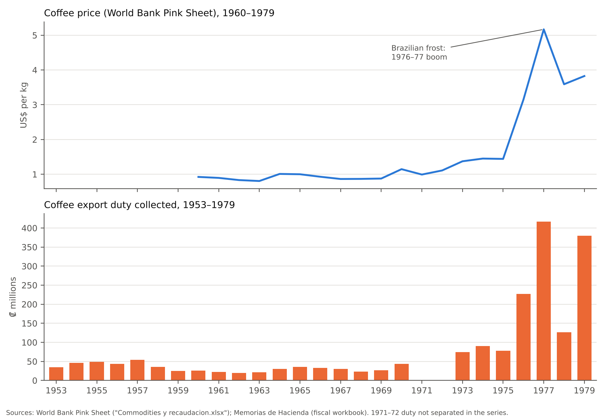
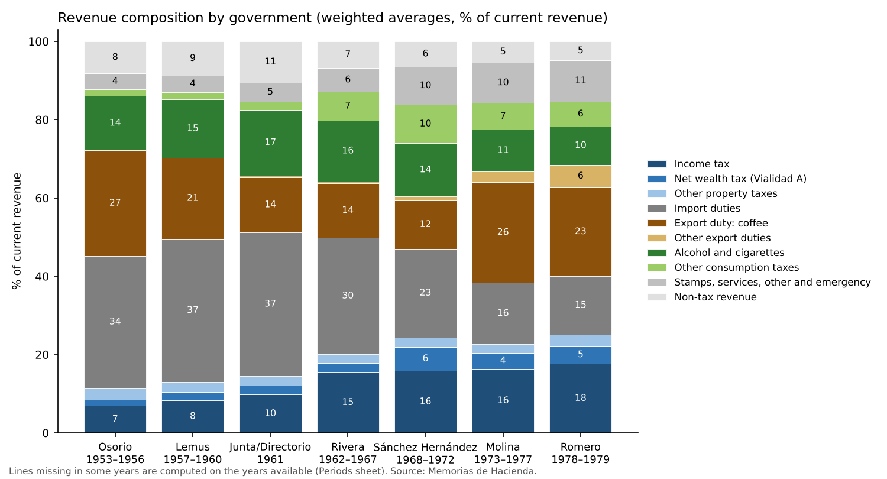
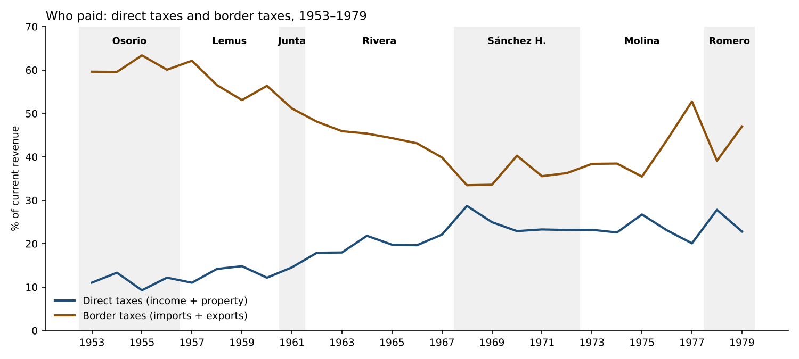
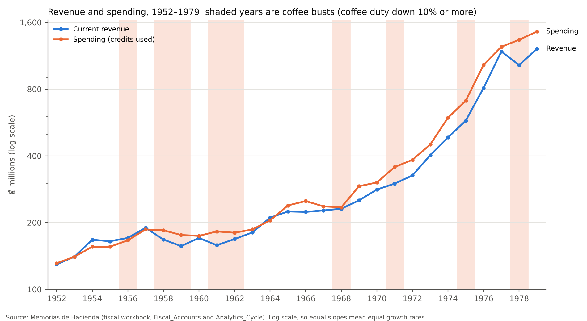
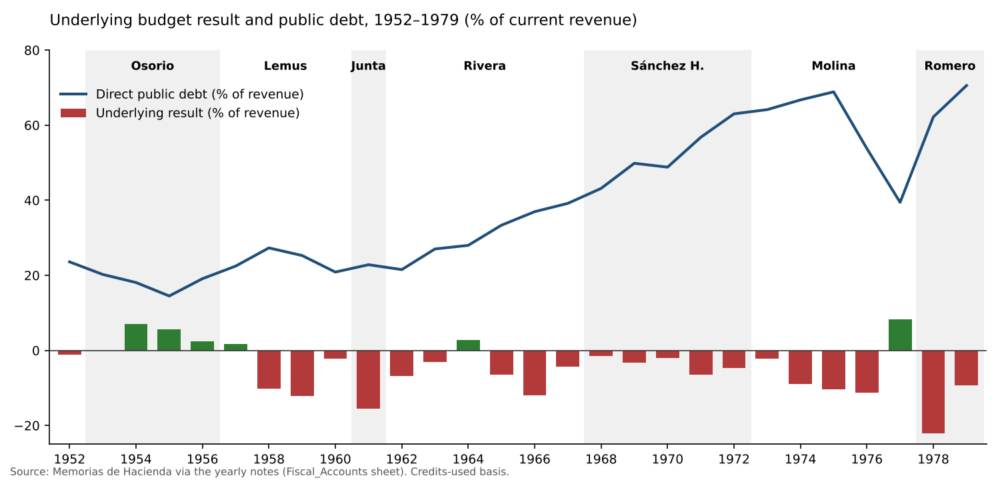
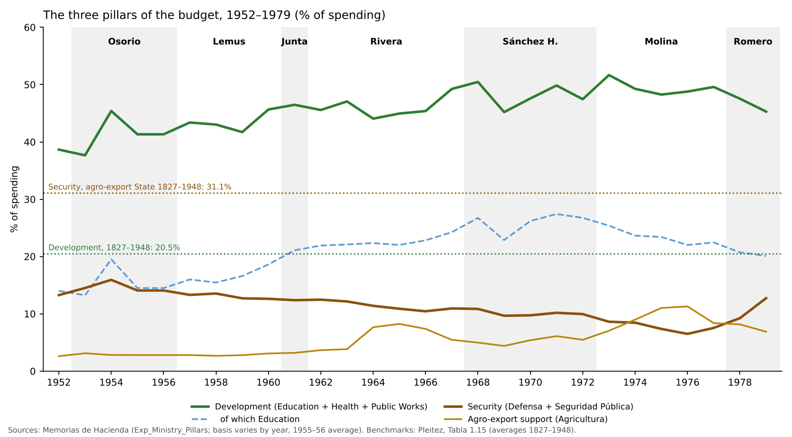
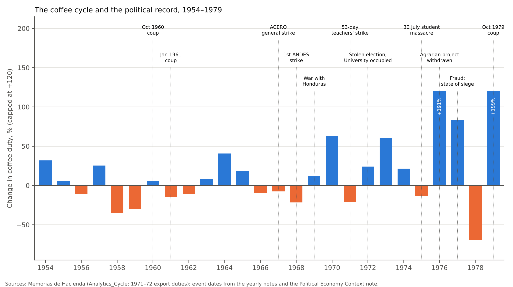

> **DRAFT.** This is a working draft for discussion with the project author. Figures, readings and verdicts are provisional and will change as the research gaps are filled. A separate, stand-alone document on the research gaps and the tasks to fill them (Diario Oficial, Central Reserve Bank, national accounts and others) will follow.

# How to read this document

**Purpose.** This document brings together everything the project has produced so far: the yearly notes on the Memorias de Hacienda from 1952–53 to 1979, the fiscal database built from them, the thematic notes, and the readings in the repository's *Literature/* folder. It tells the story the evidence supports, shows where the evidence is solid and where it is thin, and prepares the research assistants for their two tasks: building an econometric analysis on the database, and filling the gaps in the record.

**Structure.**

- **Part I** states the question and the argument, and sets out the economy and the regime.
- **Part II** presents the evidence by theme: who paid, how the State managed the coffee cycle (fiscal and monetary), the contest between development and security, the economic contradiction of modernization, the war of 1969 and the closing of the 1970s.
- **Part III** retells the record year by year, government by government, from the yearly notes.
- **Part IV** sets out where the hypotheses stand and describes the database and the econometric agenda.
- **Annex A** gives the key annual series; **Annex B** maps every document and dataset in the repository; **Annex C** lists the references.

**Sources and conventions.** All fiscal figures come from the Memorias de Hacienda (the Finance Ministry's *Informes Complementarios Constitucionales*), read on the page image and checked against printed totals, through the yearly notes and the fiscal workbook. Secondary sources give context and are checked against the Memorias or a second source. Figures are in millions of colones (₡M) at current prices; US$1.00 = ₡2.50 throughout the period. The accounting conventions (current revenue, credits used, the underlying result, the pillars) are explained in section 12 and in *Tools/Workflow_and_Conventions.md*.

---

# Part I. The question, the setting and the regime

# 1. The question and the argument in brief

**The question.** Did the fiscal and monetary management of a small, open, agro-exporting and dependent economy contribute to the political polarization that led to the civil war of 1980–1992?

**Why the fiscal record.** The budget records the regime's choices year by year: when coffee rose, the State decided what to do with the windfall; when it fell, it decided who would bear the cost. The political literature mostly infers these choices; the Memorias record them in colones.

**The argument, as a chain.** The research so far supports the following reading, which the rest of this document tests link by link.

1. **Coffee supplied the platform.** Coffee paid for the State, through the export duty and the import duties its earnings financed. The country's income, foreign exchange and revenue all moved with a price set abroad, under a fixed exchange rate.
2. **The military regime modernized from above.** From the coup of December 1948, the regime used the coffee platform to build a developmental State: new ministries and autonomous institutions, public works, and from the late 1950s import-substituting industrialization through the Central American Common Market.
3. **Modernization needed an educated workforce.** A coffee economy built on large plantations and coerced labour needed little education; industry and a more complex society needed more. The State expanded schools, the teaching corps and the University. **The development pillar grew**, to about half of spending by the late 1960s.
4. **The groups modernization created were met by the security pillar.** Teachers, students, State employees and urban workers demanded voice and better terms. The regime, under the national security doctrine of the Cold War, treated organized dissent as subversion. **The security pillar kept "order"** so that modernization could proceed, much of it off the budget and through paramilitary networks.
5. **A budgetary contest became an ideological one.** The competition between the development and security pillars, in a society with very unequal land, income and wealth, spilled over into the polarization of the 1970s.
6. **The 1969 war broke the model.** It closed the Common Market to El Salvador's manufactures and the Honduran outlet for its landless.
7. **The 1978 bust resolved the contradiction in favour of security.** When coffee and credit failed together, the regime protected security and cut education.

The fiscal accounts do not show that the budget caused the war. They show when and how the regime chose whom to protect, and how a State financed at the border and by debt handled a cycle it could not control.

# 2. The setting: a small, open, agro-exporting economy

**A price set abroad, a fixed exchange rate.** El Salvador's colón was fixed at ₡2.50 per US dollar throughout the period. With no exchange-rate adjustment, a change in the world coffee price passed directly into export earnings, into the coffee duty (levied on dollar values) and into the revenue of the State. Turcios estimates that each dollar off the coffee price cost the State about ₡1.19M in the 1950s (*Autoritarismo y modernización*, p. 147).

{width=6.3in}

The coffee market changed character over the period: a post-war windfall (the price of Salvadoran coffee rose 4.6 times between 1945 and 1954, Dada Hirezi, p. 29); low prices supported by the International Coffee Agreement in the 1960s (in force from 1963); and the boom of 1976–77 after the Brazilian frost, followed by the bust of 1978.

**The structuralist diagnosis.** The regime's development thinking came from ECLA. Prebisch's 1950 report argued that the periphery's specialization in primary exports exposed it to a deterioration in the terms of trade (36.5% between the 1870s and the 1930s) and to a cycle driven by exports rather than investment; industrialization was the way out. Singer (1950) added that export sectors behave as enclaves and that booms give the means to industrialize while removing the incentive. Hirschman (1958) showed why coffee does little on its own: its linkages are weak, and its processing adds little value. President Lemus later called the Hoselitz report of 1954 "the bible" of his economic policy (Pleitez, p. 194).

**A plantation economy with coerced labour.** Unlike Costa Rica and Colombia, El Salvador developed coffee on large plantations after the land privatizations of 1879–1881, through what Nugent and Robinson (2010) call a mass land grab by political elites, with extreme labour repression. They argue that a coercive labour market gave the landowning elite little reason to invest in education. By 1970 the land Gini was 0.83, the highest in Central America (Acevedo, 2003). Ching (2020) frames the century with a budget: in 1910 the State spent ₡0.8M on education and ₡4.5M on defence, "guns rather than schools".

**From a security State to a development State.** Pleitez's averages give the long-run benchmark: in the agro-export State (1827–1948), security took 31.1% of spending, debt service 25.6%, and education, health and public works together 20.5%. For 1948–1979 his averages are 11.3%, 3.6% and 45.6%. Our series shows that the shift happened in the 1950s.

# 3. The regime and its project, 1948–1979

**The regime.** Zamora (2019) calls it "organic militarism": the high command controlled the Executive, the Assembly and the courts; the official party (PRUD, then PCN) won elections the military had already decided; the business elite ran the economy and kept a veto over policy. The regime combined "verbal constitutionalism, developmentalism and the electoral apparatus" (p. 45). Ching (2020) describes the same regime as schizophrenic: an authoritarian dictatorship that repressed any autonomous mass movement, and at the same time a regime that "revolved around this notion of reform", in a "rocky marriage" with an elite that distrusted officers of humbler origin. Reformist rhetoric came with each new *tanda* of junior officers (1948, 1961, 1979). Salvadoran militarism, in Zamora's words, "is born and dies with the Cold War": the Armed Forces adopted anti-communism as their ideological frame, and Washington dealt directly with the high command.

**The antecedents.** The fiscal instruments of the regime had precedents under Martínez (Turcios, 2021). In the bust of 1937 the coffee export duty was cut by two-thirds "for the benefit of the producer", while external debt service was suspended. In November 1943, with wartime prices high, a new coffee duty rose with the New York price and was earmarked for paying down the public debt, on the explicit argument that times of abundance should be used to lighten the debts of earlier generations. A proposed tax on excess profits exempted coffee income.

**The project.** After 1948 the regime built the institutions of a developmental State:

- the 1950 Constitution, with a title on the economic order and social rights;
- ten ministries instead of four, and new autonomous institutions: IVU (housing), IRA (food supply), ICR (rural settlement), ISSS (social security), CEPA (the port of Acajutla) and CEL (Lempa hydroelectricity);
- the progressive coffee export tax (Decree 836, 1950), which also exempted coffee growers from income tax, and the first general income tax (1951);
- the industrial promotion law (1952) and the path to Central American integration: ODECA (1951), bilateral treaties, the multilateral treaties of 1958 and the General Treaty of December 1960. Minister Jorge Sol Castellanos called integration "part of our vital and economic needs" (Turcios, 1993, pp. 44–45). Dada Hirezi (1978) reads the strategy as industrialization "without breaking the internal social equilibrium".

**The periods.** The study assigns each year to the president inaugurated the previous 1 July.

| Period | Government | Key events |
|:--|:--|:--|
| 1948–1960, modernization from above | Consejo Revolucionario (1948–50); Osorio (1950–56); Lemus (1956–60) | 1950 Constitution; coffee tax (1950) and income tax (1951); industrial law (1952); repression of 1952; Lemus's opening and its reversal; coup of October 1960 |
| 1961–1967, opening and growth | Junta (Oct 1960) and Directorio (Jan 1961); Rivera (1962–67) | Central Bank nationalized and income-tax reform (1961); Alliance for Progress; Common Market; proportional representation (law of 1963, first used in 1964); PDC's rise; ANDES founded (1965); ORDEN created (1960 per Ching, 1966 per Zamora) |
| 1967–1972, the transition | Sánchez Hernández (1967–72) | ACERO general strike (1967); education reform and first ANDES strike (1968); war with Honduras (1969); first guerrilla group (1970); 53-day strike (1971); stolen election, failed coup, University occupied (1972) |
| 1972–1979, closure | Molina (1972–77); Romero (1977–79) | La Cayetana (1974); 30 July massacre (1975); agrarian transformation withdrawn (1976); fraud and state of siege (1977); Public Order law (1977); coup of 15 October 1979 |

---

# Part II. The evidence

# 4. The platform: who paid

**Table 1. Revenue composition by government, % of current revenue (weighted)**

| | Osorio 1953–56 | Lemus 1957–60 | Junta 1961 | Rivera 1962–67 | Sánchez H. 1968–72 | Molina 1973–77 | Romero 1978–79 |
|:--|--:|--:|--:|--:|--:|--:|--:|
| Income tax | 6.9 | 8.4 | 9.7 | 15.5 | 15.8 | 16.4 | 17.6 |
| Direct taxes (income + property) | 11.5 | 12.9 | 14.6 | 20.0 | 24.4 | 22.6 | 25.1 |
| Import duties | 33.7 | 36.6 | 36.6 | 29.9 | 22.6 | 15.7 | 15.0 |
| Coffee export duty | 27.0 | 20.6 | 14.1 | 13.8 | 12.4* | 25.6 | 22.6 |
| Border taxes (imports + exports) | 60.7 | 57.3 | 51.1 | 44.2 | 36.0 | 44.1 | 43.4 |
| Alcohol and cigarettes | 13.9* | 15.0 | 16.8 | 15.5 | 13.6* | 10.7 | 9.8 |
| Non-tax revenue | 8.2 | 8.7 | 10.5 | 6.8 | 6.4 | 5.4 | 4.8 |

*\*Split estimated from the years available. Source: revenue workbook (Memorias de Hacienda).*

{width=6.3in}

**The 1950s: a State financed at the border.** Border taxes were 61% of revenue under Osorio, coffee alone 27%. Until 1961, taxes on alcohol and cigarettes yielded more than all direct taxes together. The income tax charged individuals up to 44% but companies only 2.5–5%. Cotton, the second export crop, paid no export duty, while its exports were worth ₡39–44M a year in the late 1950s.

**The 1960s: a real change in the base.** The Directorio's income-tax reform of 1961 was partly reversed within months by an exemption for reinvested industrial profits (Pleitez, pp. 203–205), but the 1963 law, new consumption taxes and the Common Market's erosion of import duties changed the structure. Under Rivera, direct taxes rose to a fifth of revenue and coffee's share halved.

**The 1970s: back to riding coffee.** The boom of 1976–77 restored coffee to a quarter of revenue (₡417M in 1977, more than a third of that year's revenue). Corporate income tax never exceeded 7% of revenue in any period. A progressive sugar duty (1974) yielded ₡25.6M in 1975 and little afterwards; a cotton duty was considered in 1973–74 and never imposed. A land tax and higher company income tax arrived only at the bottom of the 1978 bust, and new enterprise incentives in December 1978 reduced company income tax in 1979.

{width=6.3in}

**Reading.** The tax system captured windfalls at the border and spared the income and wealth of the coffee and commercial elite; the one serious attempt to change this, in 1961, was diluted. This is the tax bargain (Track A). In Besley and Persson's (2009) terms, El Salvador never invested in fiscal capacity: even the 1969 war, the kind of common threat that built income taxes elsewhere, was paid for with bonds and Central Bank credit and left the base unchanged.

# 5. Managing the cycle: fiscal policy

{width=6.3in}

**Table 2. The coffee cycle and spending, 1954–1979 (sums of annual changes, ₡M)**

| Phase | Years | Change in revenue | Change in spending (credits used) |
|:--|--:|--:|--:|
| Boom (coffee duty up 10% or more) | 12 | +1,119.0 | +1,046.4 |
| Bust (coffee duty down 10% or more) | 9 | −69.4 | +264.4 |
| Neutral | 5 | +25.5 | +2.3 |

*Source: fiscal workbook (Analytics_Cycle).*

**Booms were spent.** In boom years, 94 centavos of each extra colón of revenue were spent; the correlation between revenue growth and spending growth over 1954–79 was 0.7. Of the extra spending in comparable boom years, about 44% went to development, 20% to education and 14% to security, close to their average shares: **the coffee money built the civilian State, not the repressive one.**

**Busts were handled in two ways.**

- **Until 1968, by running down the cushion and cutting.** The surplus built in 1954–57 (the Superávit Financiero peaked at ₡45.7M in 1957, a quarter of a year's spending) carried the busts of 1958–59. In 1966–67 the regime cut what could be postponed, school buildings, agricultural programmes, public works and the IRA's food subsidy, and protected salaries and the University.
- **From 1971, by borrowing.** In the busts of 1971, 1975 and 1978 spending rose by ₡52.8M, ₡115.1M and ₡92.7M.

**Debt took the strain.** Direct debt was 15–27% of revenue through 1962, 39% at the end of Rivera's term, 63% at the end of Sánchez Hernández's, fell to 39% at the end of Molina's because the boom tripled revenue, and reached 71% in 1979. Debt was cheap (implicit interest of 2–5%; interest never above 2.3% of revenue): what ran out was new lending and the Central Bank's room.

{width=6.3in}

**Measured against Prebisch's rule.** Prebisch (1950, pp. 50–51) set out the compensatory rule for an export economy: in the upswing the State should not use the extra tax revenue for public investment, but accumulate it "in anticipation of bad times or use[] it to repay bank credit extended during the preceding contraction". He immediately doubted it could be followed, because asking governments to save for their successors "would mean making the success of anti-cyclical action depend on attitudes not always compatible with sound political interest". The Martínez government had stated the rule in 1943. The regime of the 1950s partly followed it (the cushion of 1954–57), and the 1970 and 1973 windfalls were used first to repay the Central Bank. But from 1974 the regime spent the boom, and in 1977, the one year of comparable surplus, the windfall was used to repay the Central Bank, cut arrears and lend ₡100M to public institutions rather than to build a buffer. Singer's paradox applies: the boom gave the means and removed the incentive.

**The asymmetry is the core finding.** Spending followed revenue up and did not follow it down. In Acemoglu and Robinson's (2001) model, highly unequal societies have volatile fiscal policy; the coffee cycle gave El Salvador's that volatility a precise rhythm.

# 6. Managing the cycle: monetary policy

**What we know.** The monetary side of the research question is the least documented. The Memorias record only the Treasury's dealings with the Central Bank; the rest needs Central Reserve Bank data. The evidence so far:

- **The exchange rate was fixed at ₡2.50 per dollar** throughout. There was no devaluation to cushion a coffee bust; the fall in dollar prices passed fully into colón revenue (a mechanism stated as a hypothesis in Note MH 1959, to be tested).
- **The Central Bank (BCR) was founded in 1934 as a private company** with a monopoly of issue, its management given to the propertied groups, as was the Banco Hipotecario, 40% owned by the coffee growers' association (Zamora, pp. 35–36). **It was nationalized in 1961** by the Directorio. Pleitez dates a Fondo de Desarrollo Económico to 1966 and a Junta Monetaria to 1973.
- **Central Bank credit to the Treasury became a standing instrument:**

| Year | Central Bank credit to the Treasury (from the yearly notes) |
|:--|:--|
| 1954 | Short-term BCR loan, repaid in early 1955 |
| 1962 | The General Fund borrowed ₡15.5M from the newly nationalized BCR |
| 1963 | ₡10M of BCR credit converted into bonds |
| 1964–1966 | No Central Bank debt (1964); the 1965 deficit was covered by loans rather than Central Bank credit |
| 1967 | The Treasury returned to Central Bank notes (₡6M) after three years without them |
| 1968 | Notes rose from ₡6M to ₡10M |
| 1969 | The war was financed partly with Central Bank notes; the Memoria states for the first time that ₡20.0M of Treasury notes are held by the BCR |
| 1970–1971 | The 1969 advances were repaid, but a new ₡10M advance replaced the last one: the Treasury's debt to the BCR never fell below ₡10M |
| 1972 | Central Bank credit rose to ₡17.4M |
| 1973 | The coffee windfall cleared it (₡17.4M to ₡0.7M) |
| 1976 | ₡12.0M of Central Bank advances, repaid in 1977 |
| 1978 | Central Bank advances again (₡8.0M), repaid in 1979 |

- **Quasi-fiscal operations ran through the Central Bank.** The IRA's losses on stabilizing grain prices were financed by the Central Bank until the Treasury took them over with bonds in 1970; the industrial development institute INSAFI's liabilities were later taken over by the Central Bank (World Bank, 1983).
- **Inflation arrived in the 1970s.** National CPI (Central Reserve Bank, via the World Bank): +19.0% in 1975, +7.1% in 1976, +11.8% in 1977, +13.3% in 1978 and +14.1% in 1979. Total remunerations rose only about 4–4.5% in real terms in 1977 and 1978, and 1.3% in 1979.

**What this suggests.** Central Bank credit to the Treasury followed the coffee cycle: it rose in bad years and was repaid in good ones, and from 1969 it became a permanent facility. With a fixed exchange rate, the room for this financing depended on the reserves that coffee earned. Prebisch's alternative to fiscal compensation was monetary: manage the import coefficient, postpone durable imports in downswings, and use reserves and international lending to cover the gap. Whether the BCR did any of this is the central open question of this section.

**What is missing.** Money supply, international reserves, credit to the private sector and to coffee, interest rates and the BCR's balance sheet, 1950–1979; the holders of government bonds; and the coffee financing operations (for example the ₡30M Treasury loan to the Compañía Salvadoreña de Café in 1975). These go to the research-gaps document.

# 7. Development against security: the two pillars

{width=6.3in}

**The pillars as measured.** Development (Education, Health, Public Works) rose from 38% of spending in 1952–53 to about half in 1968–1973 (51.7% in 1973). Education rose from 13–14% to a peak of 27.4% in 1971 (30.4% on Pleitez's basis), then declined almost every year to 20.1% in 1979. Security (Defensa and Seguridad Pública) fell from 13–16% in the 1950s to 6.5% in 1976, then doubled to 12.7% in 1979.

**Why the regime spent on development.** Singer (1950) saw manufacturing as the "growing point" for "urban education" and skills. The regime's modernization required educated workers and created them: primary enrolment grew 4–5% a year through the 1960s, secondary enrolment jumped after the 1968 reform, and University enrolment almost quadrupled between 1967 and 1974. In Acemoglu and Robinson's (2000) terms, the regime also used spending as a concession to the groups it created.

**How the teachers fared: more posts, not better pay.** The evidence on teachers suggests that the education budget grew mainly through numbers rather than pay (H2, suggestive):

- teachers' pay rose 1.5% in 1963, 3.6% in 1970 (the best revenue year of that cycle), and 6.5% in 1971, while the Fuerza Armada's budget grew 15.6%; it rose by a quarter only in 1972, after the strike;
- by 1967 the private teacher-training schools produced up to 3,500 graduates a year, while the Ministry absorbed about 880; about 5,000 qualified teachers were seeking posts;
- the number of schools stayed almost flat (about 3,000–3,250) while enrolment grew by half; pupils per teacher were about 40 in cities and 60 in the countryside in 1976.

ANDES was founded in June 1965; its first national strike came in 1968, and the 53-day strike of 1971 over the salary scale was declared illegal and broken by the National Guard.

**The security pillar understates security.** The ministry totals miss much of the regime's coercion:

- **extraordinary budgets and bonds** (₡10M for arms in 1968; the war of 1969, see section 9);
- **the Presidency's discretionary lump sums**, which rose from ₡7.4M in 1970 to ₡20.3M in 1974 (Zamora) and were ₡19.4M in 1977;
- **paramilitary networks**: ORDEN recruited up to 100,000 rural people (Ching), and the *patrullas cantonales* of ex-conscripts policed the countryside (Zamora). Acemoglu, Robinson and Santos (2013) show how such networks persist when they deliver votes to those who would otherwise remove them.

**A prediction the data contradict.** Acemoglu, Ticchi and Vindigni (2010) cite El Salvador's 1950s regime as a military dictatorship built by the elite for repression, and predict that very unequal nondemocracies spend little on public goods and much on the military. Our series shows the opposite until 1978. Three readings reconcile them: the army had its own modernizing project; repression was cheap and off the budget; and the turn came with scarcity.

**The head-to-head of 1978.** When coffee fell 30% in 1978 and revenue fell 13%, security rose ₡29.7M while education fell ₡2.1M, the largest such shift in the series. In 1979 Defensa rose 42% and Seguridad Pública 71%, most of it through transfers between appropriations rather than votes of the Assembly.

**The coalition pillar.** A unit-level review of the 1977 budget (MH 1978, Estado IV-2) shows how lopsided a budget-only comparison is. Development took ₡510.3M (50.5%), security ₡84.3M (8.3%), and coalition spending on the budget only ₡17.1M (1.7%), including ₡6.96M paid by Interior to the municipalities "to compensate for the suppression of taxes on the cultivation of coffee" and ₡4.8M for the San Bartolo export free zone. The coalition was served through the tax system: the coffee income-tax exemption, untaxed cotton (forgone duty of ₡10–55M a year in the years examined, 1–6% of revenue), industrial exemptions and bank credit.

# 8. The economic contradiction: educated groups without a place

**Industry grew, jobs did not.** Under the Common Market, manufacturing grew 8.1% a year in 1960–70, and manufactures rose from 5.6% to 28.7% of exports; but industry created jobs at only 1.7% a year in 1961–71, while open unemployment in the sector rose from 5% to 9%. Industrial workers fell from 13% to 11% of the labour force; 75% of industry and 40% of the urban population were in metropolitan San Salvador (Acevedo, 2003). Rural underemployment reached 47% in the mid-1970s.

**Education without returns.** Acevedo finds that secondary enrolment had a negative effect on productivity growth over 1962–2000; one explanation he cites is that returns to education fall when supply expands while the demand for educated labour stagnates. Hausmann and Rodrik (2005) find the same for the 1990s: low and falling returns to schooling, because "more education is likely to lead mainly to lower returns to human capital rather than to higher incomes" when something else constrains growth. The complexity framework explains the constraint: the variety of skills an economy can use depends on what it produces (Hidalgo and Hausmann, 2009), and coffee and garments sit in the sparse periphery of the product space, from which countries move only to nearby products (Hidalgo et al., 2007). Productivity growth turned negative in the 1970s, before the war (Acevedo).

**The groups that resulted.** The teacher surplus of 1967, the University's expansion and an industry that did not absorb the educated produced the actors of the protests: ANDES, the students' association AGEUS, and the FUSS union federation (14 unions in 1965, 40 in 1967). Prebisch had predicted the mechanism in 1949: in an agricultural country slumps lower rural income, but "when relatively large industrial masses are concentrated in the cities … the cyclical unemployment problem would assume serious social complications".

**Import substitution as industrial policy.** Hausmann and Rodrik note that protection "drove diversification and industrialization in the 1960s and 1970s. Coffee profits were invested in industry largely because high trade barriers in the region created profitable import-substituting opportunities." The industrial exemptions counted in the coalition pillar were the instruments of that policy. Whether they moved the economy toward more complex products, or mainly protected the incomes of the families who owned the new firms, can be tested with product-level trade data from 1962.

# 9. The break: 1969

**The Common Market's imbalance.** Hirschman (1958) described the "polarization effects" of uneven industrialization within a market: the lagging region "will now have to buy Northern manufactures, produced behind newly erected tariff walls", and loses its skilled people. Within the Common Market, El Salvador was the industrial "North" and Honduras the "South"; by the mid-1970s two-thirds of El Salvador's industrial exports went to the Common Market. Between 150,000 and 300,000 Salvadorans were working land in Honduras when Honduras began enforcing its land reform against them (Acevedo; Bulmer-Thomas).

**How the war was paid for.**

- In March 1968 an extraordinary Defence budget (D.L. 609) of ₡9.84M bought equipment for the armed forces, financed with ₡10M of 7% Treasury bonds.
- On 2 July 1969, twelve days before hostilities began, the Assembly approved a one-time emergency tax and an emergency provision. In July and August ₡30M of "National Dignity" bonds were authorized; ₡22.1M were sold.
- Emergency spending reached ₡41.0M in 1969, one and a half times the ordinary Defence budget; about 90% of what was paid that year was machinery and equipment.
- Including 1968, the effort of about ₡51M was financed 63% with domestic bonds, 18% with the emergency tax and 19% with ordinary funds, in practice Central Bank notes. **Four-fifths of the war was borrowed.**
- The coffee price rise of 1970 raised the duty by 63%, to ₡43.1M, and cleared the war's Central Bank advances.

**What the budget left out.** Between 60,000 and 130,000 Salvadorans were expelled from or fled Honduras. The Memorias record no spending on their resettlement. They returned to a country where about a third of rural families were landless. Because the war was financed outside the ordinary budget, the security pillar measured from ministry totals actually fell in 1969 (9.7% of spending).

**Reading.** The war closed the Honduran safety valve (Track B) and the regional market on which the more complex part of the economy depended. The State found money for arms in weeks; it found none for the returnees.

# 10. The closing: 1972–1979

{width=6.5in}

**Polarization accelerated in a good fiscal year.** In 1972 coffee recovered and the regime paid the teachers, but the presidential election was stolen, a military revolt was put down with about a hundred dead, and the University was occupied and its funding cut. The fiscal hypothesis is not the whole story: the regime closed the political channels when it had money.

**Concessions without commitment.** Acemoglu and Robinson (2000) argue that concessions within an unchanged regime are not credible, because "current transfers do not ensure future transfers"; only institutional change commits the elite. The Salvadoran regime offered reversible concessions, budget-financed and coffee-dependent, and closed the institutional route: the stolen elections of 1972 and 1977, the 1974 land law not enforced, the 1976 agrarian transformation withdrawn in October after four months of attack led by the business association ANEP and the landowners' paramilitary FARO. In 1976 the agrarian institute ISTA received ₡36.8M, but the land bonds were never issued: the regime funded "the reform agency but not the reform". De facto power undid formal reform (Acemoglu and Robinson, 2008).

**Repression grew with the windfall, then took the margin.** Defence and public security spending grew 40% in 1977, the year of the fraud, the Plaza Libertad shootings, the state of siege, the killing of two priests and the Public Order law. In the 1978 bust security rose while education and investment paid; in 1979 security took the margin of the coffee recovery, reaching an eighth of the budget, and the tax bargain was relaxed again. On 15 October 1979 young officers deposed Romero.

**Busts and crises.** In Acemoglu and Robinson's (2001) model, revolt and regime change are more likely in recessions, when the opportunity cost of protest is low. The chart above lines up the coffee cycle with the political record: the coups of 1960–61 followed the bust of 1958–59 and the fall of 1961; the 1971 strike came in a bust; the coup of 1979 followed the bust of 1978. But the frauds of 1972 and 1977 came in good coffee years. The relationship is a hypothesis to test, not a finding.

---

# Part III. The record year by year, 1952–1979

*This part condenses the yearly notes (Policy and Technical Notes/), in the words of each note's summary where possible. Each year gives current revenue, spending (credits used) and the underlying result as a share of revenue (Annex A). The technical diagnostic notes for each year add the IMF-style indicators, vulnerability matrix and data gaps.*

## Osorio, 1952–1956: the boom and the cushion

**1952–53.** Revenue had doubled since 1949 on the post-war and Korean War commodity boom, with more than half from customs. The budget was in small deficit in 1951–53, covered from accumulated surpluses of only ₡4–7M. Public works generated most commitments, and a fifth of them were never executed: investment was already the elastic part of the budget. Development ministries took three and a half to four times the share of defence. Debt service was about 4% of payments, and the debt stock was falling.

**1954.** The first surplus of the reformed budget (₡11.7M on a commitment basis). Coffee duties explained 41% of the revenue increase and a one-off succession tax another quarter. The Superávit Financiero rose from ₡5.5M to ₡20.0M. Education and public works grew fastest, but the defence share rose for the third consecutive year. The income tax stagnated while trade taxes surged: the boom deepened the dependence on coffee and customs.

**1955.** A pause, not a reversal: revenue fell 1.6% only because the 1954 estate-tax windfall did not recur. The budget stayed in surplus (₡9.1M) and the Superávit Financiero reached ₡35.1M. Spending was flat; education and defence purchases fell about 15% while payrolls were protected. Debt reached its lowest level of the period (₡23.9M, 14.5% of revenue). The Carretera del Litoral, the first large IBRD-financed project, began.

**1956.** Spending rose 6.9% and the surplus fell to ₡4.2M. The coffee channel appeared: coffee duties fell ₡5.5M. Debt rose 36% as IBRD drawings began. Development took 41% of credits used, security about 14%. The cushion doubled to ₡39.9M, about a quarter of a year's spending, giving the incoming Lemus government room to absorb a downturn without borrowing.

## Lemus, 1957–1960: the coffee bust and the crisis

**1957.** Record revenue (₡189.5M), driven by coffee: export duties provided half the increase, while the income tax grew more slowly than taxes as a whole. A small surplus (₡3.2M) and a large cushion (₡45.7M). Debt rose 30.6% with IBRD drawings for the Litoral highway. Development took 43.4% of credits used, security 13.3%. The Ministry was already taking precautions against "a sudden fall in revenue".

**1958: the coffee crisis hits the fisc.** Coffee duties fell 35% and revenue 11.5%. With no stabilization fund, the shock passed straight into the balance, which swung from a surplus to a deficit of ₡17.0M. The government did not cut spending; it drew the Superávit Financiero down from ₡45.7M to ₡31.2M and left 36% of capital credits as unpaid commitments. The income tax, up 15.4%, was the one growing source.

**1959.** A second deficit (about ₡19M), financed from the cushion, which fell to ₡18.0M. Export duties fell another 30%, all of it coffee. Spending was cut only 4%, and capital spending carried the adjustment while the wage bill (about half of credits used) held. Development took 41.7%, security 12.7%. The fixed exchange rate passed the fall in world prices fully into colón revenue.

**1960.** *(No yearly note yet: the 1960 Memoria is in the repository but has not been processed; figures from the 1961 note and the 1948–1960 note.)* Revenue recovered to ₡170.5M and the deficit narrowed to 2.2% of revenue; the Superávit Financiero rose to ₡20.3M. The fiscal record does not show exhaustion before the coup: the crisis of 1960 was political. Lemus's opening of 1956–57 had been reversed by repression, the University was sacked by the police, and on 26 October Lemus was deposed.

## The Junta and the Directorio, 1961

**1961: from the Junta to the Directorio.** Spending rose while revenue fell: education rose 18.6% to a record 21.1% of spending, education wages 19.9%, while capital credits fell 15%. The rise can be read as a political choice by a Junta whose civilian members came from the University and the opposition. The Directorio nationalized the Central Bank, reformed the income tax and created INSAFI. The regime entered 1962 without a buffer, with a larger and more rigid payroll, and with teachers and the University more dependent on the budget than ever.

## Rivera, 1962–1967: opening, growth and the first downturn

**1962.** Authoritarian reformism inherited an empty treasury and a budget enlarged by the Junta. It did not reverse the education expansion. It adjusted by taxing higher incomes, cutting the ordinary budget's own investment and borrowing ₡15.5M from the Central Bank it had just nationalized, while opening a foreign-financed investment channel under the Alliance for Progress.

**1963.** Rivera's first full year consolidated the adjustment: consumption taxes, a payroll held almost flat, Central Bank credit turned into long-term debt, and infrastructure moved into foreign-financed programmes. Teachers' pay rose only 1.5%: fiscal pressure on teachers appeared as wage restraint rather than cuts. Proportional representation was adopted, opening the Assembly to the opposition from 1964.

**1964.** Coffee recovered and the new income tax took hold: revenue jumped 17%. The government spent about half, raising education and teachers' pay, giving the University its first capital grant and holding defence nearly flat, and saved the rest, ending with a surplus and no Central Bank debt. AID programme loans entered the budget. "The upswing did not polarize through the budget; it bought room."

**1965.** At the top of the cycle the windfall was spent: a general wage increase, 52% more for the University, a capital budget up 70% and a third financed by AID and IDA loans. The budget returned to deficit, covered by loans. Teachers did less well than the rest of the payroll, and in June they founded ANDES.

**1966.** When coffee turned down, the government did not squeeze education, teachers or the University: payroll rose 10%, the University's grant 14%, health 15%. It cut investment and spent the entire 1965 surplus, ending with no buffer and ₡9.6M owed to its own funds.

**1967.** With no buffer left, the government cut what could be postponed: school buildings, agricultural programmes, public works and the IRA's food subsidy. It protected salaries and the University, gave the army more, and closed the gap with arrears, loans from its own funds and Central Bank notes. The ACERO strike became a general strike in April; Honduras began enforcing its land reform against Salvadoran settlers. "Protect people, cut buildings and food."

## Sánchez Hernández, 1968–1972: the war and the closing

**1968.** A third lean year: investment was halved, and the gap was closed with arrears to the social security institute and short-term Treasury notes. Revenue shifted toward direct taxes on property and wages. Education and health kept expanding, because the buildings of the loan-financed boom needed staff. The political opening peaked (PDC 19 seats) and the teachers struck nationally for the first time. At the same time the State found ₡10M outside the budget to equip the army: "protect people, cut buildings, and arm off-budget".

**1969: the war year.** At the bottom of the coffee cycle, El Salvador went to war with Honduras and paid for it outside the ordinary budget, with a one-time tax, patriotic bonds and Central Bank notes. It did not cut schools, hospitals or roads, and it restored investment. The war was fought on credit, and the return of tens of thousands of landless Salvadorans was not budgeted at all. "Protect the budget, arm on credit, leave the returnees to the market."

**1970.** The coffee windfall paid off the war's Central Bank advances, settled debts to social security with land, absorbed the IRA's losses and raised investment by two-thirds. It did not raise teachers' pay meaningfully (+3.6%) or tax the boom beyond the coffee duty. Politics closed: the PCN swept the elections, the agrarian congress led nowhere, the police got a ministry, and the FPL was founded. "Use the windfall to clean the books and build, not to buy consent."

**1971.** Coffee fell and revenue missed its target by 6.5%. Current spending was frozen in June as the teachers struck for 53 days for a salary scale the 1970 windfall had not given them; the strike was broken by force while the army's budget grew more than twice as fast as teaching. Investment was protected with debt (direct debt up a quarter), the Central Bank line stayed open, and the revenue gap was filled with stamp and consumption taxes. "Contain the teachers, protect the investment with debt, tax consumption."

**1972.** Coffee recovered. Teachers' pay rose by a quarter after the strike, and investment continued with debt; the tax system, which the Treasury itself described as among the least productive in the developing world, was not reformed. The election was stolen, a revolt was crushed and the University occupied. "Pay the teachers, punish the University, close the ballot box."

## Molina, 1973–1977: the boom, the agrarian project and the fraud

**1973.** Coffee boomed: the Central Bank was repaid, public works grew by two-thirds and external debt for the large projects of 1973–77 began to accumulate. The University was refinanced under government-appointed administrators. The teachers' raise was not repeated; the Presidency's discretionary lump sum nearly doubled. "Build with the windfall and borrow for more, repay the Central Bank, keep wages in check."

**1974.** Coffee stayed high, oil prices tripled and the regime spent: revenue rose a fifth, credits used a third, and the comparable deficit quadrupled to about 9% of revenue. Investment, defence, the Presidency and agriculture grew fastest; pay rose nearly a fifth to keep up with inflation. The National Guard massacred peasants at La Cayetana. "Spend the boom on everything, including security, and repress the peasants." The end of fiscal caution.

**1975.** Coffee prices were flat and the duty fell, but revenue rose a fifth as income tax jumped by half and a new sugar duty taxed the sugar boom. Agriculture and health grew, financed by the IDB, the World Bank and AID; defence barely grew; the comparable deficit reached 10% of revenue. The Treasury lent ₡30M to the coffee company. On 30 July troops fired on a student march; the BPR was founded weeks later. "Tax income and sugar, support coffee, spend on the countryside, and shoot the students."

**1976.** The Brazilian frost doubled the coffee price and almost tripled the duty: revenue rose 40%. The windfall was spent (wages up almost a third, public works up four-fifths), and the comparable deficit widened to 11% of revenue; the paper surplus rested on ₡237M of unsold bonds. The agrarian transformation was launched in June and gutted in October; ISTA was funded but the land bonds were never issued. Security rose by more than a quarter, and the Minister of Defence became the official candidate. "Spend the windfall, tax coffee only at the border, fund the reform agency but not the reform, and choose the general."

**1977.** The coffee peak: the duty brought in ₡417M, more than a third of revenue, and the budget was in comparable surplus for the first time in the series (an underlying surplus of 8.3% of revenue). The windfall repaid the Central Bank, cut arrears and lent ₡100M to public institutions. It was also the year of the fraud, Plaza Libertad, the state of siege, the killing of two priests, the White Warriors' ultimatum to the Jesuits and the Public Order law; defence and public security grew 40%. "Save the windfall, tax coffee only at the border, lend to the State's own enterprises, and fund the repression."

## Romero, 1978–1979: security first

**1978.** The coffee price fell 30% and the duty 70%; revenue fell 13% but spending rose 7.5%, and the comparable deficit swung from a surplus of 8% of revenue to a deficit of 18.5%, the worst of the series. Education fell in nominal terms and investment was cut, while Defence rose 37%. The bust exposed ₡60M of unpaid contributions to social security. The Treasury returned to the Central Bank and to foreign lenders; direct debt rose 37%. A land tax and higher company income tax arrived only at the bottom; ISTA's funding was cut by three-fifths. "Revenue falls, security rises, education and investment pay, and the State borrows from its own institutions."

**1979.** Coffee revenue returned on record volumes and revenue rose 18%. The recovery went to investment and, above all, to security: Defensa +42% and Seguridad Pública +71%, mostly through transfers between appropriations; education, health and agriculture fell in real terms. Company income tax fell after new incentives. Direct debt passed 70% of revenue. On 15 October young officers deposed Romero. "Coffee money returns, security takes the margin, the tax bargain is relaxed, and the regime falls anyway."

---

# Part IV. Where we stand

# 11. The hypotheses and the evidence

**Table 3. Preliminary verdicts**

| Hypothesis | Verdict | Evidence | What is missing |
|:--|:--|:--|:--|
| H1 Education and University squeezed in downturns | Suggestive | Protected in 1961, 1966–67; relative decline from 1971; cut in 1978 | University series; real spending per student |
| H2 Teachers' wages contained | Suggestive | Small raises in 1963 and 1970; 1971 strike; posts grew faster than pay | Posts and salaries (Ley de Salarios, Diario Oficial); CPI before 1974 |
| H3 Investment cut first | Supported | 1958–59, 1966–68, 1978 | Economic classification 1957–69 and 1973 |
| H4 Central Bank financing / monetary policy | Partly supported | Standing facility from 1969; rises in busts, repaid in booms | BCR data on money, reserves and credit |
| H5 Food subsidies cut | Open | IRA subsidy cut 1967; losses pushed to the Central Bank until 1970 | IRA transfers and losses, 1960–80 |
| A Tax bargain | Strongly supported | Coffee exempt from income tax; corporate tax ≤7% of revenue; untaxed cotton; 1961 reform diluted | Cost of exemptions; income tax by sector |
| B Honduran safety valve | Supported | No budget for 60,000–130,000 returnees; war financed by debt | Returnees' settlement; trade with Honduras |
| C Protection bargain | Supported from 1977–78 | Security +40% (1977), doubled in 1978–79; extraordinary budgets in 1968–69 | Paramilitary and off-budget security; Presidency lump sums |
| D Reforms announced, then diluted | Supported | 1961 income tax; 1974 land law; 1976 agrarian transformation | Decrees and their implementation |

**Four hypotheses from the political-economy literature** (see *Literature/Reading_Notes/Reading_Note_Political_Economy_Theory.md*):

1. **Concessions were temporary, not committed** (Acemoglu and Robinson, 2000). Test: trace each concession (education, wages, land, taxes) through the following bust.
2. **Busts raised the threat** (Acemoglu and Robinson, 2001). Test: the boom and bust years against strikes, protests and coups.
3. **Repression was cheap until it was not** (Acemoglu, Ticchi and Vindigni, 2010; Acemoglu, Robinson and Santos, 2013). Test: the security pillar against off-budget and paramilitary security.
4. **Polarization kept fiscal capacity narrow** (Besley and Persson, 2009). Test: the share of direct taxes and the fate of tax reforms, including after 1969.

**Caveats.** The results are shares and changes in nominal colones, from about 27 annual observations; they show timing and association, not causation. The pillars are measured from ministry totals and are provisional until validated with unit-level and off-budget data. The 1960s were years of real growth (5.6% a year) and reform: the argument is not that the economy failed, but that the way the State shared gains and losses narrowed the paths open to the groups it had created.

# 12. The database and the econometric agenda

**The database.** All series come from the Memorias through the verified yearly notes.

| Dataset | Content | Years |
|:--|:--|:--|
| *Fiscal Accounts 1952-1979/El_Salvador_Fiscal_Accounts_Memorias_1952_1979.xlsx* | The core workbook: Fiscal_Accounts (revenue, credits used, gastos, commitments, underlying result, interest, amortization, debt, Superávit Financiero); Exp_Ministry_Pillars; Exp_Economic; Periods_Fiscal; Analytics_Cycle (boom/bust); plus the revenue sheets | 1952–1979 |
| *Revenue Data 1952-1990/El_Salvador_Revenue_Memorias_1952_1979.xlsx* | Revenue by source in modern categories (Revenue_CM), detail (income tax split, coffee and other export duties, Vialidad), periods, shares, tax laws, mapping, reconciliation | 1952–1979 |
| *Revenue Data 1952-1990/All_revenue_1952_1990.csv* and long files | Line-by-line revenue extraction (Lukas Chaves's database), R scripts | 1952–1990 |
| *Revenue Data 1952-1990/tax_burden_memoria_1967_1979.csv* | Tax burden, GDP and national income as reported by the Memorias | 1967–1979 |
| *Revenue Data 1952-1990/Commodities y recaudacion.xlsx* | World Bank Pink Sheet: coffee, sugar and cotton prices | 1960–1980 |
| *Spending Data/ministry_class_1952_1960.csv*, *ministry_class_1961_1979.csv* | Spending by ministry (*ramo*), unit and object class, with source page and verification flag | 1952–1979 (1957–59 class detail missing) |
| *Spending Data/pillars_1952_1960.csv*, *pillars_1961_1979.csv* | Pillar totals and shares | 1952–1979 |
| *Loans and Investment/loan_financed_projects_1955_1979.csv* | Loan-financed projects: lender, instrument, counterpart, amounts | 1955–1979 |
| *War and Security Data/war_cost_1968_1980.csv* | The cost of the 1969 war and its financing | 1968–1980 |
| *Education Data/schools_teachers_enrollment_1956_1980.csv* | Enrolment, schools and teacher indicators from published sources | 1956–1980 |

**Conventions.** Current revenue excludes bond proceeds and loans. The main spending basis is **credits used** (payments plus commitments outstanding at year-end); some years are on a gastos basis and are flagged. The **underlying result** is the commitment-basis balance excluding loan-financed capital commitments, on-lending and non-cash payments. The **pillars**: development = Educación + Salud Pública + Obras Públicas; security = Defensa + Seguridad Pública; agriculture and Interior are memo lines. From 1974 the Superávit Financiero includes unsold bonds booked as revenue receivable. Unit lines from the 1974 volume on report the previous year's budget.

**The econometric agenda** (from *Spending Data/Note_Expenditure_Econometrics_MTFF_Ideas.md*). With about 27 observations and structural breaks, the agenda favours transparent tests, using the coffee price as a well-measured exogenous shock:

1. **Cyclicality and asymmetry:** the change in spending (total and by component) on the change in revenue, the coffee duty or the coffee price, testing whether booms raise spending more than busts cut it.
2. **Where the windfalls went:** each component's change on the change in coffee revenue (security, education, the University, investment, wages, debt repayment), the cleanest quantitative test of H1–H5.
3. **Event studies** around the 1958–59 bust, the 1969 war, the 1970 windfall, the 1976–77 boom and the 1978 bust.
4. **Revenue and spending dynamics:** an error-correction model of whether revenue drove spending or the reverse.
5. **Fiscal impact on growth:** local projections with the coffee price as instrument, the least precise with this sample.
6. **The link to polarization:** fiscal variables against protest and repression events (Almeida, 2008), as association, not causation.
7. **A retrospective medium-term fiscal framework and stress tests:** coffee price and volume shocks, the loss of the Common Market, the war, an interest-rate shock, and counterfactuals such as a coffee stabilization fund for 1976–78.

**New measures from the readings.** Product-level trade data from 1962 (Feenstra et al.; the Atlas of Economic Complexity) would allow measures of export diversity, economic complexity and export sophistication (EXPY) for 1962–79, to set against the education and coffee series.

**What the econometrics needs first** (detailed in the forthcoming research-gaps document): GDP and a price index before 1968 and 1974; population; coffee export volumes and unit values; the 1957–59 spending detail; the economic classification for 1957–69 and 1973; a complete interest and amortization series; the 1960 Memoria; Central Reserve Bank monetary series; Diario Oficial data on posts, salaries, decrees and exemptions; and protest-event data.

---

# Annex A. Key annual series, 1952–1979

| Year | Revenue (₡M) | Spending, credits used (₡M) | Underlying result (% rev.) | Coffee duty (₡M) | Debt (% rev.) | Security (% spending) | Development (% spending) | Education (% spending) |
|:--:|--:|--:|--:|--:|--:|--:|--:|--:|
| 1952 | 129.7 | 131.2 | −1.2 | — | 23.6 | 13.3 | 38.7 | 14.0 |
| 1953 | 140.3 | 140.3 | 0.0 | 35.0 | 20.2 | 14.5 | 37.7 | 13.2 |
| 1954 | 167.4 | 155.7 | 7.0 | 46.2 | 18.1 | 15.9 | 45.4 | 19.5 |
| 1955 | 164.8 | 155.7 | 5.5 | 49.0 | 14.5 | 14.1 | 41.3 | 14.5 |
| 1956 | 170.6 | 166.4 | 2.5 | 43.5 | 19.1 | 14.1 | 41.3 | 14.5 |
| 1957 | 189.5 | 186.3 | 1.7 | 54.5 | 22.5 | 13.3 | 43.4 | 16.0 |
| 1958 | 167.7 | 184.7 | −10.1 | 35.4 | 27.3 | 13.5 | 43.0 | 15.5 |
| 1959 | 156.7 | 175.8 | −12.2 | 24.8 | 25.3 | 12.7 | 41.7 | 16.6 |
| 1960 | 170.5 | 174.3 | −2.2 | 26.3 | 20.9 | 12.6 | 45.7 | 18.6 |
| 1961 | 158.1 | 182.5 | −15.4 | 22.3 | 22.8 | 12.4 | 46.5 | 21.1 |
| 1962 | 168.6 | 180.0 | −6.8 | 19.9 | 21.5 | 12.5 | 45.6 | 21.9 |
| 1963 | 180.5 | 186.3 | −3.2 | 21.6 | 27.0 | 12.2 | 47.1 | 22.1 |
| 1964 | 210.5 | 204.6 | 2.8 | 30.5 | 28.0 | 11.4 | 44.1 | 22.3 |
| 1965 | 224.5 | 239.0 | −6.4 | 36.0 | 33.4 | 10.9 | 44.9 | 22.0 |
| 1966 | 223.5 | 250.1 | −11.9 | 32.6 | 37.0 | 10.4 | 45.4 | 22.8 |
| 1967 | 226.9 | 236.6 | −4.3 | 30.1 | 39.2 | 10.9 | 49.2 | 24.2 |
| 1968 | 231.0 | 234.4 | −1.5 | 23.7 | 43.2 | 10.9 | 50.5 | 26.7 |
| 1969 | 251.9 | 291.9 | −3.3 | 26.5 | 49.9 | 9.7 | 45.2 | 22.9 |
| 1970 | 281.8 | 303.3 | −2.0 | 43.1 | 48.8 | 9.7 | 47.6 | 26.2 |
| 1971 | 299.8 | 356.1 | −6.5 | — | 56.8 | 10.2 | 49.8 | 27.4 |
| 1972 | 326.4 | 383.7 | −4.7 | — | 63.0 | 10.0 | 47.5 | 26.7 |
| 1973 | 402.7 | 450.0 | −2.2 | 74.0 | 64.1 | 8.6 | 51.7 | 25.4 |
| 1974 | 484.4 | 594.5 | −8.9 | 90.0 | 66.7 | 8.5 | 49.3 | 23.6 |
| 1975 | 576.8 | 709.6 | −10.3 | 78.0 | 68.9 | 7.4 | 48.3 | 23.4 |
| 1976 | 810.0 | 1,028.1 | −11.2 | 227.2 | 53.8 | 6.5 | 48.8 | 22.0 |
| 1977 | 1,181.8 | 1,241.9 | 8.3 | 416.8 | 39.4 | 7.5 | 49.6 | 22.4 |
| 1978 | 1,026.9 | 1,334.6 | −22.0 | 126.9 | 62.2 | 9.2 | 47.5 | 20.7 |
| 1979 | 1,215.4 | 1,453.3 | −9.3 | 379.5 | 70.6 | 12.7 | 45.3 | 20.1 |

*Source: fiscal workbook (Fiscal_Accounts; Exp_Ministry_Pillars). Pillar shares use the basis of each year (credits used, or gastos in 1964–66 and 1970–72); 1955–56 is a biennial average. Debt: direct public debt at year-end (1950s: total public debt). Coffee duty 1971–72: export duties not separated in the series (₡38.2M and ₡47.5M total export duties in the cycle analysis).*

# Annex B. Map of the repository

**Primary sources.** *Memorias de Hacienda/*: the Memorias and Informes Complementarios Constitucionales, 1952–1979 (no volumes for 1948–51 or 1980).

**Yearly notes** (*Policy and Technical Notes/*), each with a working note (Note_MH) and a technical diagnostic (Technical_Note_Fiscal_Diagnostic):

- 1952–53; 1954; 1955; 1955–56; 1957; 1958; 1959 (Word files only for 1954–59);
- 1961 to 1979, one pair per year;
- no note yet for 1960.

**Thematic notes.**

| Document | Content | Used in |
|:--|:--|:--|
| *Policy and Technical Notes/Note_Political_Economy_Context_1948_1980.md* | Political context, hypotheses H1–H5 and Tracks A–D, chronology 1960–80 | Sections 1, 3, 11 |
| *Policy and Technical Notes/Note_Loan_Financed_Investment_1955_1962.md* | The three channels of public investment; the Carretera del Litoral | Sections 5, 12 |
| *Papers/Note_1948_1960_Modernization_from_Above.md* | The founding decade | Sections 2–4, Part III |
| *Papers/Article_Draft_Riding_the_Coffee_Cycle.md* | Test draft of the article (12 Nov 2026) | Throughout |
| *Papers/Preliminary_Paper_Outline_for_Discussion.md*, *Outline_Note_1948_1960_for_Discussion.md* | Outlines and decisions | Structure |
| *Papers/Note_Validating_the_Three_Pillars.md* | Where the pillar measure can mislead; validation tests | Sections 7, 11 |
| *Papers/Note_Coalition_Pillar_Balancing.md*, *Note_Pillars_Unit_Review_Pilot_1977.md* | The coalition on the tax side; the 1977 unit-level review | Section 7 |
| *Papers/Compendium_Working_Notes_November_2026.md*, *Compendium_Latest_Notes_1948_1960_and_Pillars.md* | Compilations of the November notes | — |
| *Papers/Note_Nation_Building_Reading_for_Discussion.md*, *Bibliography/References_Nation_Building_Framework.md* | A nation-building reframing, discussed on 13 November and set aside by the author on 21 November | Not used |
| *Fiscal Accounts 1952-1979/Note_Fiscal_Accounts_Expenditure_First_Results.md* | Design and first results of the fiscal workbook | Sections 5, 12 |
| *Revenue Data 1952-1990/Note_Revenue_Series_Design_and_Discussion.md* | Design and findings of the revenue series | Section 4, 12 |
| *Spending Data/Note_Expenditure_Econometrics_MTFF_Ideas.md* | Expenditure workbook, econometric options, retrospective fiscal framework | Section 12 |
| *Education Data/Note_Education_Schools_Teachers_1956_1980.md* | Enrolment, schools, teachers | Sections 7, 8 |
| *Bibliography/Data_Gaps_and_Sources_1948_1980.md* | Inventory of data gaps | Section 12; basis of the forthcoming gaps document |
| *Bibliography/Reading_List_Structuralism_Complexity_Coffee.md* | Reading list for the 1948–1960 note | Sections 2, 8 |
| *Bibliography/Bibliography_External_Sources.md* | Web and secondary sources consulted, by note | Throughout |
| *Tools/Workflow_and_Conventions.md* | Conventions, verification rules, OCR tools | Section 12 |

**Literature** (*Literature/*, indexed in *Literature/README.md*; reading notes in *Literature/Reading_Notes/*):

- *History_and_Politics/*: Zamora (2019); Ching (2020); Turcios (1993, 2017, 2021); Griffith.
- *Development_Models/*: Dada Hirezi (1978); Pleitez (chapters 1–2); Acevedo (2003); Morales (IMF, 1998).
- *ECLA_and_Development_Theory/*: Prebisch (1950); Singer (1950); Hirschman (1958).
- *Complexity_Framework/*: Hausmann and Rodrik (2005); Hidalgo and Hausmann (2009); Hidalgo et al. (2007); Hausmann, Hwang and Rodrik (2007).
- *Political_Economy_Theory/*: Acemoglu and Robinson (2000, 2001, 2008); Acemoglu, Ticchi and Vindigni (2010); Acemoglu, Robinson and Santos (2013); Nugent and Robinson (2010); Besley and Persson (2009).
- *Ellacuria_ECA_Editorials/*: five ECA editorials (1971, 1976 ×3, 1978).
- *World_Bank_Reports/*: Economic Memoranda of 1974, 1979 and 1983.

**Data** (section 12): *Fiscal Accounts 1952-1979/*, *Revenue Data 1952-1990/*, *Spending Data/*, *Loans and Investment/*, *War and Security Data/*, *Education Data/*.

# Annex C. References

Acemoglu, D. and J. A. Robinson (2000). "Why Did the West Extend the Franchise?" *Quarterly Journal of Economics* 115(4): 1167–1199.

Acemoglu, D. and J. A. Robinson (2001). "A Theory of Political Transitions." *American Economic Review* 91(4): 938–963.

Acemoglu, D. and J. A. Robinson (2008). "Persistence of Power, Elites, and Institutions." *American Economic Review* 98(1): 267–293.

Acemoglu, D., J. A. Robinson and R. J. Santos (2013). "The Monopoly of Violence: Evidence from Colombia." *Journal of the European Economic Association* 11(S1): 5–44.

Acemoglu, D., D. Ticchi and A. Vindigni (2010). "A Theory of Military Dictatorships." *American Economic Journal: Macroeconomics* 2(1): 1–42.

Acevedo, C. (2003). *El crecimiento económico en El Salvador durante la segunda mitad del siglo XX*. Washington, DC: Inter-American Development Bank.

Almeida, P. (2008). *Waves of Protest: Popular Struggle in El Salvador, 1925–2005*. University of Minnesota Press.

Besley, T. and T. Persson (2009). "The Origins of State Capacity: Property Rights, Taxation, and Politics." *American Economic Review* 99(4): 1218–1244.

Ching, E. (2020). "El Salvador." In R. H. Holden (ed.), *The Oxford Handbook of Central American History*, ch. 20. Oxford University Press.

Dada Hirezi, H. (1978). *La economía de El Salvador y la integración centroamericana, 1945–1960*. UCA Editores.

Hausmann, R., J. Hwang and D. Rodrik (2007). "What You Export Matters." *Journal of Economic Growth* 12(1): 1–25.

Hausmann, R. and D. Rodrik (2005). "Self-Discovery in a Development Strategy for El Salvador." *Economía* 6(1): 43–101.

Hidalgo, C. A. and R. Hausmann (2009). "The Building Blocks of Economic Complexity." *PNAS* 106(26): 10570–10575.

Hidalgo, C. A., B. Klinger, A.-L. Barabási and R. Hausmann (2007). "The Product Space Conditions the Development of Nations." *Science* 317: 482–487.

Hirschman, A. O. (1958). *The Strategy of Economic Development*. Yale University Press.

Ministerio de Hacienda, El Salvador. *Memorias de Hacienda (Informes Complementarios Constitucionales)*, 1952–1979.

Nugent, J. B. and J. A. Robinson (2010). "Are Factor Endowments Fate?" *Revista de Historia Económica* 28(1): 45–82.

Pleitez, W. Chapters 1–2 of a history of El Salvador's development models (full reference to be confirmed).

Prebisch, R. / ECLA (1950). *The Economic Development of Latin America and its Principal Problems*. United Nations, E/CN.12/89/Rev.1.

Singer, H. W. (1950). "The Distribution of Gains between Investing and Borrowing Countries." *American Economic Review* 40(2): 473–485.

Turcios, R. (1993). *Autoritarismo y modernización: El Salvador 1950–1960*. Ediciones Tendencias.

Turcios, R. (2017). *Rebelión: San Salvador 1960*. CENICSH/MINED.

Turcios, R. (2021). *Larga dictadura*, 2º fascículo. Editorial UEES.

World Bank (1979). *Economic Memorandum on El Salvador*, Report No. 2287-ES. World Bank (1983). *El Salvador: Updating Economic Memorandum*, Report No. 4054-ES.

Zamora, R. (2019). *Siglo XX. Sociedad y Estado*. INFOD, Colección Bicentenario 3.
