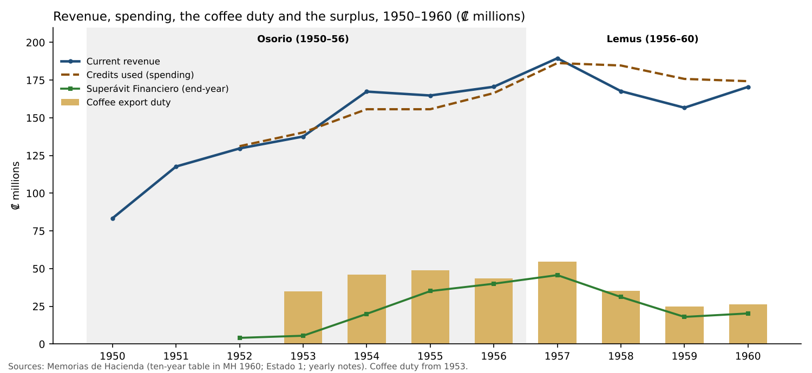
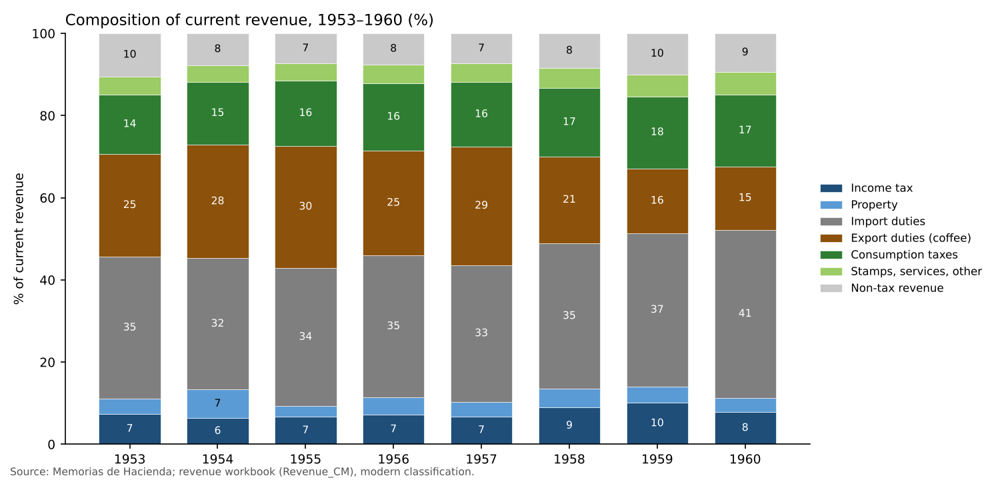
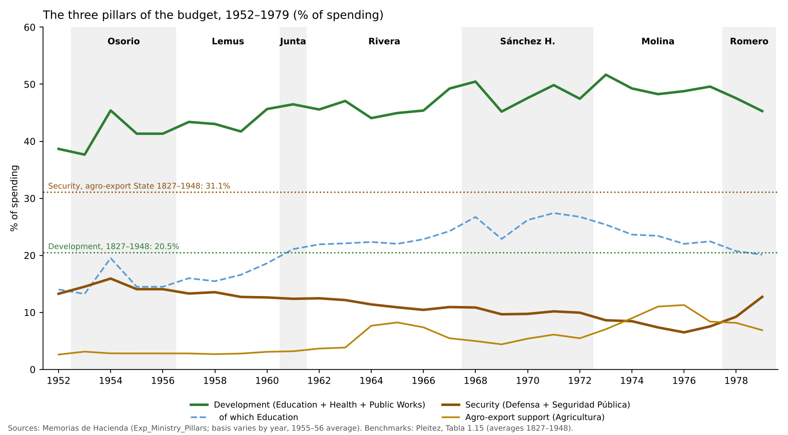
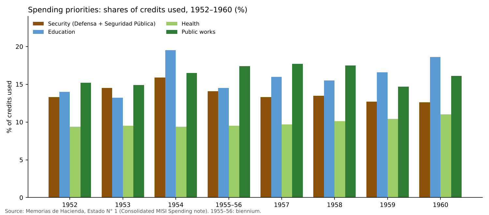
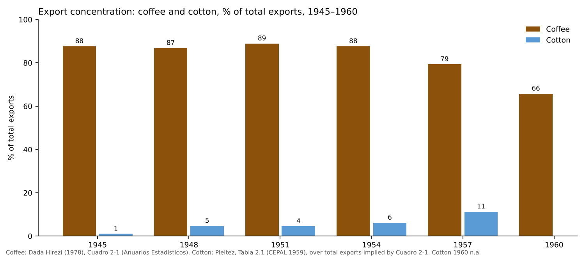

# Modernization from Above: Coffee, the State and the Forces Beneath the Stability, El Salvador 1948–1960

**Working note — first draft for discussion, 12 November 2026.** This note covers the founding decade of the project of modernization, from the coup of December 1948 to the fall of President Lemus in October 1960. It is written to feed the preliminary paper (*Riding the Coffee Cycle*). Figures come from the Memorias de Hacienda, through the verified yearly notes and the revenue and fiscal workbooks, and from the three works that frame the decade:

- Roberto Turcios, *Autoritarismo y modernización* (1993) and *Rebelión: San Salvador 1960* (2017);
- William Pleitez, chapters 1–2 of his history of El Salvador's development models;
- Héctor Dada Hirezi, *La economía de El Salvador y la integración centroamericana, 1945–1960* (1978).

Page numbers are the printed pages of each work. Points still to verify are marked as such.

---

## Summary

1. **The point of departure was a coffee economy and a coffee State.** Around 1950 coffee was more than 80% of exports (88–89% in 1945–1954). The State's tax base rested on trade.
2. **The modernization of 1948–1960 was financed by a windfall.** The coffee price per quintal multiplied 4.6 times between 1945 and 1954. The new government captured part of it with a progressive export tax (1950), and tax revenue roughly tripled between 1946 and 1951.
3. **The money went to a developmental State:**
   - schools, health and public works took 38–46% of spending;
   - the security apparatus took 13–16%, a share that drifted down;
   - large infrastructure (the Lempa dam, the Litoral highway, the port of Acajutla) was financed with foreign loans and State guarantees.
4. **The tax bargain was written for the coffee and commercial elite.** Coffee paid at the border but was exempt from income tax. Companies paid 2.5–5% against up to 44% for individuals. The 1952 industrial law added exemptions. Taxes on alcohol and cigarettes yielded more than all direct taxes together.
5. **Diversification began but stayed thin.** Cotton rose from 1% to 11% of exports (1945–1957); coffee's share fell from 88% to 66% by 1960. Industry was small: in the early 1950s only 14 factories employed more than 100 workers.
6. **The 1958–59 coffee fall was managed without a fiscal crisis.** The surplus built in the boom absorbed the first year. New consumption taxes and cuts in public works and Defence handled the second. Education was protected.
7. **The stability was partly superficial.** The regime combined social reform with repression:
   - a state of siege in 1951;
   - the mass arrests of September 1952;
   - the 1952 law "in defence of the democratic order";
   - an imposed election in 1956.
   It built a State that created new groups (teachers, students, State employees, professionals, urban workers) without giving them political voice. The crisis of 1960 was political, and these groups were at its centre.

**Proposition for the paper:** the 1950s built both the expectations (a developmental State, education, a middle class) and the fiscal model (coffee, trade and a light tax on capital) whose collision would define the 1970s.

---

## 1. Introduction

The author's reading is that, until the end of the Rivera administration (1967), El Salvador was guided by the project of modernization begun by Colonel Óscar Osorio after the coup of 14 December 1948. The decade looked stable:

- one official party, the PRUD, governed continuously;
- the economy grew on high coffee prices;
- the State built roads, schools, hospitals, a dam and a port.

But forces were born and built up under that surface, and they would become decisive in the 1970s:

- a technical cadre;
- a middle class;
- organized students and workers;
- and a habit of repressing them.

This note asks three questions:

1. What were the economy and the State at the start?
2. What did the reforms try to change, and how were they financed?
3. What was building up beneath the stability?

It adds three things to the existing narrative literature:

- the fiscal record, verified year by year from the Memorias de Hacienda (1952–1960);
- the international setting: development thought and the coffee market;
- a first, descriptive look at diversification.

---

## 2. The point of departure, c. 1948

### 2.1 A coffee economy

On the eve of the 1948 coup, El Salvador was a small, densely populated, rural economy built around one export.

- **Coffee was the economy's link to the world.** It was 87.6% of exports in 1945 and 86.8% in 1948 (Dada Hirezi, Cuadro 2-1, pp. 28–29).
- **Production grew slowly; prices did the work.** Coffee export volume rose only from 57.7 thousand tonnes (1945) to 60.3 (1948) and 65.9 (1951). Export value doubled between 1945 and 1948 (₡46.7M to ₡90.4M), and doubled again by 1951 (₡190.1M).
- **Output rose through labour, not land.** Dada Hirezi stresses that the coffee frontier was closed; higher output came from more labour per hectare and from fertilizer (pp. 29–30).

### 2.2 A State shaped by 1932

The rural rebellion of January 1932 and its repression left two legacies that matter here.

- **A military regime allied to the coffee elite.** Martínez governed until 1944, and the army remained the arbiter of politics afterwards.
- **A policy of containing change.** Dada Hirezi argues that the Martínez regime protected artisans and small workshops, to avoid the unemployment that had fed the 1932 alliance. Examples:
  - a 1939 decree prohibited factories with capital above ₡20,000 in several lines;
  - machinery for sugar mills and cotton gins was banned (DH 1A, ch. 1).
  - Economic policy was used to contain a political threat. This mechanism is the subject of this project.

### 2.3 Instability, 1944–1948

- Between 1940 and 1948 strikes, mobilizations and military revolts ended the Martínez dictatorship and kept the country unstable (Pleitez, p. 188).
- The coup of 14 December 1948 brought a Consejo de Gobierno Revolucionario (CGR) to power. Its members called it not a "golpe" but "a movement of renewal, to achieve the new organization of the State" (Pleitez, p. 188, citing Turcios).
- The CGR's *Proclama de principios y objetivos* (25 December 1948) promised, among other things:
  - higher living standards, "guaranteeing the growth of production, under the protection of technique";
  - stimulus to private enterprise;
  - social justice;
  - Central American economic ties (Pleitez, p. 189).

### 2.4 The State's finances before the Memorias

Our series of Memorias starts in 1952. For the late 1940s, a United Nations study of 1957, reproduced by Dada Hirezi (Cuadro 2-6, p. 38), gives central-government tax revenue.

**Table 1. Tax revenue of the central government, 1946–1954 (₡ millions)**

| Tax | 1946 | 1949 | 1951 | 1954 |
|:--|--:|--:|--:|--:|
| Income tax | 2.66 | 5.14 | 5.95 | 10.62 |
| Property | 0.46 | 0.86 | 0.96 | 2.85 |
| Property transfers | 1.48 | 1.01 | 2.45 | 10.13* |
| Export duties | 4.50 | 11.80 | 34.27 | 46.24 |
| Import duties | 15.03 | 28.20 | 42.85 | 53.51 |
| Internal consumption taxes | 8.64 | 13.03 | 17.99 | 26.67 |
| Other | 3.95 | 4.00 | 5.20 | 6.89 |
| **Total** | **36.72** | **64.04** | **109.67** | **156.91** |
| Export duties, % of total | 12.3% | 18.4% | 31.2% | 29.5% |

*Source: United Nations, *La política tributaria y el desarrollo económico en Centroamérica* (1957), p. 123, as reproduced by Dada Hirezi, Cuadro 2-6. The table was read from a scanned copy. The components add to the totals for 1946–1951. \*The 1954 transfers figure is derived from the printed total (the scan is illegible). It reflects a large succession tax that year, which the 1954 Memoria confirms (₡8.8M). Shares computed here.*

Three points stand out:

- **Tax revenue tripled in five years** (1946–1951), and rose fourfold by 1954.
- **The export tax was the engine.** Export duties rose sevenfold between 1946 and 1951, from 12% to 31% of tax revenue. Pleitez gives the same order of magnitude: 14.3% in 1948 and an average of 29.8% in 1951–1957 (p. 200).
- **The income tax was marginal:** 7% of tax revenue in 1946, and still 5.4% in 1951.

The Memorias' own ten-year series begins in 1950. Ordinary revenue was ₡83.4M in 1950 and ₡117.7M in 1951, a jump of 41% in the first year of the new coffee tax (MH 1959 and MH 1960).

A fuller picture of the State's finances at the start of the decade is in Wallich and Adler's study for the Salvadoran government (*Public Finance in a Developing Country: El Salvador — A Case Study*, Harvard University Press, 1951; Spanish edition by the Fondo de Cultura Económica). The author holds a copy; it will be added when scanned.

---

## 3. The international setting

### 3.1 Development thought: ECLA, Prebisch and the Hoselitz mission

The modernization project drew explicitly on the new development economics.

**ECLA's structuralism.** Under Raúl Prebisch, ECLA divided the world economy into a centre and a periphery:

- The **centre** had homogeneous, diversified productive structures.
- The **periphery** was heterogeneous and specialized: technical progress was confined to export activities in unstable markets.

Because productivity grew faster at the centre, and the periphery's terms of trade tended to deteriorate, ECLA concluded that "average incomes diverge over time more intensely than productivities". It prescribed:

- industrialization;
- a larger domestic market;
- regional integration;
- growth poles;
- gradual import substitution, beginning with consumer goods (Pleitez, pp. 194–195, citing Prebisch [1949] and Rodríguez).

**The studies commissioned by the government.** The government commissioned studies that shaped both its organization and its policies (Pleitez, pp. 192–194). The most influential was by the UN industrial expert **Bert F. Hoselitz**, *Industrial Development of El Salvador* (1954). President Lemus later called it "the bible" of his economic policy (Pleitez, p. 194).

Hoselitz started from the observation that El Salvador's main resource was its population. He named the main problems:

- the low standard of living of the majority;
- strong seasonal variation in employment;
- heavy dependence on coffee;
- scarce skilled labour;
- a small domestic market.

Industrialization would:

- create more stable jobs;
- diversify production away from coffee;
- prepare Central American integration;
- reduce dependence on imported consumer goods;
- raise skills and wages.

His prescription was:

- light industry: food, textiles, leather, building materials;
- an input–output study of the links between industries;
- an aggressive education and training plan;
- a Central American free-trade area with a common external tariff;
- a development corporation (Pleitez, pp. 195–196).

**The size of the challenge.** Hoselitz counted only 14 factories employing more than 100 workers, and at most 32 employing more than 50 (Turcios, *Autoritarismo*, p. 43). He also noted the prevailing business maxim that an enterprise was worthwhile only if it promised a 50% profit within a year.

**Integration.** Integration became the strategy's centrepiece. On 16 June 1951, at ECLA's fourth session, the Central American ministers of economy agreed a three-point programme:

- wider markets;
- coordinated investment;
- trade liberalization.

El Salvador's minister, **Jorge Sol Castellanos**, was among its strongest promoters. He said that for El Salvador the Common Market was not an ideal but "part of our vital and economic needs" (Turcios, *Autoritarismo*, pp. 44–45). Bilateral free-trade treaties followed. They led to the multilateral treaties of 1958 and the General Treaty of 1960.

**Dada Hirezi's reading of the outcome.** He notes that the form integration finally took (broad free trade with a high common external tariff, rather than ECLA's planned, reciprocal model) suited the Salvadoran agro-export and import groups. In his reading it consolidated the existing class structure.

### 3.2 The coffee regime: controls, decontrol and the producers' agreements

The author's view is that commodity exporters operated under arrangements in which prices were set by oligopoly, and that these favoured small countries like El Salvador. The sources support this view for the 1940s and the 1960s. They qualify it for the 1950s.

- **The war years: an assured market, at a capped price.** The Inter-American Coffee Agreement of 1940, backed by the United States, gave Latin American producers export quotas in the US market (ICO, *History*). During the war prices were controlled and the United States was practically the only buyer of Salvadoran coffee (Dada Hirezi, p. 29). The Salvadoran price rose only from ₡23.31 per quintal (1941) to ₡37.24 (1945) (Dada Hirezi, p. 29, n. 2).
- **Decontrol and the post-war boom.** After 1945 world trade shed its wartime restrictions and demand grew faster than supply. Producers organized:
  - the Federación Cafetalera Centroamérica–México (FEDECAME), founded in 1946 under the leadership of the Salvadoran Roberto Canessa, pressed to end the "price ceilings" agreed with the United States (Pleitez, pp. 190–191);
  - Canessa's line in 1954: "If the North Americans want to pay less for a cup of coffee, the Latin American countries … also want to pay less for automobiles, refrigerators and other goods from the United States" (Pleitez, p. 191, n. 9).
- **How far prices rose.** The price of Salvadoran coffee went from ₡37.24 per quintal in 1945 to ₡102.53 in 1950 and ₡170.09 in 1954: an index of 100, 275 and 457 (Dada Hirezi, p. 29; Turcios, *Autoritarismo*, p. 33). Coffee export value rose from ₡46.7M (1945) to ₡230.0M (1954), while production rose only 24% (1945–1955).
- **The 1950s boom was a market windfall, not a cartel price.** The producers' attempts to support prices came as prices fell after 1954, not before:
  - a "gentleman's agreement" on minimum prices among Latin American producers (1954);
  - the Mexico Agreement (1957);
  - the Latin American Coffee Agreement (1958);
  - the first short-term International Coffee Agreement (1959/60), which brought in the African producers (ICO, *History*).
  - These agreements slowed the fall but did not stop it. Turcios's price for Central American milds fell from US$65.20 per quintal (1956–57) to US$41.72 (1959–60) (*Autoritarismo*, p. 145). Dada Hirezi's export price index (1953 = 100) fell from 125 in 1954 to 91 in 1958 and 74 in 1959 (p. 62).
- **The effective cartel came in the 1960s.** The 1962 International Coffee Agreement, with the United States as a member after the policy shift of the Alliance for Progress, set export quotas for all members. It entered into force in 1963 (ICO, *History*). This fits the author's view that prices were supported in the Rivera years.

*To verify:* whether the United States paid premium prices for Latin American agricultural commodities in the early 1950s (the Korean War years, and any US price ceilings on coffee in 1951). The sources consulted so far describe the reverse in the 1940s (ceilings), and a market-driven boom in the early 1950s.

### 3.3 The Cold War in the isthmus

The decade's politics were shaped by the Guatemalan revolution (1944–1954) and its overthrow in 1954.

- Turcios shows how the Osorio government read Guatemala as a threat.
- In late 1952 El Salvador began to press in the Organization of Central American States (ODECA) for regional action against communism, which "did not need much acuity to be read as an initiative against the Guatemalan government" (*Autoritarismo*, p. 81).
- Anti-communism became a frame for internal repression (section 6).

---

## 4. The modernization project, 1948–1960

### 4.1 The 1950 Constitution: a State with a social mandate

The Constitution of 1950 made the State the promoter of national development (Pleitez, pp. 189–190, citing Guidos Véjar).

- Article 2 obliged the State to ensure "liberty, health, culture, economic well-being and social justice".
- Article 135 required the economic regime to respond "essentially to principles of social justice".
- Article 137 guaranteed private property "in its social function".
- Article 182 declared labour a social function and committed the State to "employ all the resources within its reach" to provide employment.

### 4.2 Institutions

The decade created or activated most of the institutions of the developmental State:

| Area | Institution | Date |
|:--|:--|:--|
| Electricity | **CEL**, the Lempa hydroelectric commission (the 5 de Noviembre dam) | Created by decree in 1945; operating from September 1948 (Pleitez, p. 215, n. 58) |
| Social security | **ISSS** | Social security law of 1949; new law of 1953 (DO 226, t. 161); first clinics from 1954 (Pleitez, p. 225) |
| Housing | **IVU** (urban housing) and the Instituto de Colonización Rural, replacing Mejoramiento Social | Early 1950s; Constitution art. 148 declared housing of social interest (Pleitez, p. 220) |
| Industrial credit | **INSAFOP** (Instituto Salvadoreño de Fomento de la Producción) | 1950s. Pleitez notes it limited itself to medium-term credit for low-risk projects (p. 210) |
| Integration | Bilateral treaties, then the multilateral treaties of 1958 and the General Treaty of 1960 | 1951–1960 |

The technical cadre came from the University and the 1944 generation.

- **Reynaldo Galindo Pohl:** a student leader in 1944, member of the CGR and Minister of Education.
- **Jorge Sol Castellanos:** Minister of Economy.
- **Enrique Porras and Humberto Costa:** Finance.
- **Businessmen in office:** Roberto Canessa and Víctor de Sola, president of CEL from 1950 to 1978 (Pleitez, pp. 198–199; Turcios, *Autoritarismo*, ch. 1).

The University's support for the 1948 movement was explicit at the start. The students' newspaper wrote that "the University Youth has traditionally been combative" (Turcios, *Autoritarismo*, ch. 1). That support did not last (section 6).

### 4.3 The fiscal reforms

The reforms of 1950–1953 built the tax system that would last, with changes, until 1961.

| Decree | Content | Reading |
|:--|:--|:--|
| D. 836 (CGR), 13 Sep 1950 | Coffee export tax made *ad valorem* and progressive (10% up to US$30 per quintal, rising to 30% on the excess above US$40). Coffee producers exempted from income tax on income from coffee land while the tax applies | Captures the windfall at the border; **builds an income-tax exemption for coffee into the system**; makes revenue more sensitive to the coffee price |
| D. 510, 10 Dec 1951 | Income tax: 28 brackets for individuals (3–44%); two for companies (2.5% and 5%); withholding on wages | A wide gap between individuals and companies |
| D.L. 661, 22 May 1952 | *Ley de Fomento de Industrias de Transformación*: duty-free imports for 5–10 years; income and local tax exemptions | The origin of industrial tax expenditures |
| D.L. 1308, 22 Dec 1953 | *Ley de Vialidad*: "Serie A", a tax on net wealth | A wealth tax at very low rates (about 2% of revenue in the 1950s) |
| February 1959 | New taxes on beer and soft drinks, matches and liquor | Response to the coffee fall; also to offset revenue lost to the new protective tariff (Turcios, *Autoritarismo*, p. 143) |

*Sources: Pleitez, pp. 200–207; Note on the revenue series; Turcios.*

Dada Hirezi summarizes the economic policy of the 1948 regime in nine measures (pp. 37–38):

- the end of wage payment in kind;
- repeal of the restrictions on capital accumulation;
- the higher coffee export tax, "allowing a transfer of the surplus from the agro-export sector to other sectors";
- reform of the income tax;
- roads that opened land to cotton;
- incentives through credit and fiscal advantages;
- a dam that cut electricity prices by 25%;
- bilateral free-trade treaties;
- social security and **urban unions under government control**.

His summary: a State that took greater responsibility for capital accumulation, seeking "industrialization without breaking the internal social equilibrium", the result of "a renewed hegemonic alliance" (p. 38).

### 4.4 Spending and the large works

The government spent the windfall on a developmental State (section 5.2). The largest works were financed outside the current budget:

- **The 5 de Noviembre dam (CEL):** through the autonomous agency, with State guarantees.
- **The Litoral highway:** an IBRD loan from 1954 (D.L. 1702), with the General Fund paying 57% of the cost over 1955–1962.
- **The port of Acajutla (CEPA):** through the port authority.

See *Note on Loan-Financed Investment 1955–1962*; Turcios, *Autoritarismo*, pp. 93–94.

The boom paid for the current budget and the counterpart funds; the big investments were financed by debt.

---

## 5. The fiscal record, 1950–1960

### 5.1 Revenue: a State financed at the border

{width=6.5in}

Ordinary revenue doubled in the decade, from ₡83.4M (1950) to ₡170.5M (1960), about 7.4% a year. The path followed coffee:

- a jump in 1951, the first year of the new coffee tax;
- a peak of ₡189.5M in 1957;
- a fall of 12% in 1958 and 7% in 1959;
- recovery in 1960.

{width=6.5in}

**Table 2. Composition of current revenue, 1953–1960 (%)**

| | 1953 | 1954 | 1955 | 1956 | 1957 | 1958 | 1959 | 1960 |
|:--|--:|--:|--:|--:|--:|--:|--:|--:|
| Income tax | 7.4 | 6.4 | 6.7 | 7.2 | 6.8 | 9.0 | 10.1 | 7.9 |
| Property | 3.6 | 7.0 | 2.6 | 4.2 | 3.5 | 4.5 | 3.9 | 3.4 |
| Import duties | 34.7 | 32.0 | 33.6 | 34.6 | 33.3 | 35.4 | 37.3 | 40.9 |
| Export duties (coffee) | 25.0 | 27.6 | 29.7 | 25.5 | 28.8 | 21.1 | 15.8 | 15.4 |
| Consumption taxes | 14.4 | 15.4 | 15.8 | 16.4 | 15.7 | 16.7 | 17.5 | 17.4 |
| Stamps, services, other | 4.4 | 4.0 | 4.2 | 4.6 | 4.5 | 4.8 | 5.4 | 5.6 |
| Non-tax revenue | 10.4 | 7.7 | 7.3 | 7.5 | 7.4 | 8.5 | 10.0 | 9.3 |

*Source: revenue workbook (Revenue_CM), Memorias de Hacienda, mapped to modern categories. Income tax excludes the Vialidad net wealth tax, which is in property. Export duties are almost entirely coffee: cotton paid no export duty.*

What the composition shows:

- **Border taxes were 60% of revenue** (import and export duties together): 61% under Osorio and 57% under Lemus.
- **Coffee alone was 25–30% of revenue in the boom.** It fell to 15–16% in 1959–60.
- **Direct taxes were small.** Income tax was 6–10% of revenue. The net wealth tax (Vialidad) brought in ₡1.2–3.8M a year. Successions were the only property tax of weight, and erratic (₡8.8M in 1954, against ₡1.6–4.3M in the other years).
- **Mass taxes outweighed direct taxes.** Alcohol and cigarettes together (₡23–27M a year) yielded more than income and property taxes combined in every year with data (1954–1960).
- **Cotton was almost untaxed.** The second export crop paid no export duty. The only trace is a small tax "Sobre el Algodón" recorded under consumption taxes (₡0.29M in 1956, ₡0.35M in 1957, ₡0.03M in 1958). Cotton exports were then worth ₡39–44M a year.

**The exposure.** With the colón fixed at ₡2.50 per dollar since 1935, the coffee price passed directly into revenue. Turcios estimates that each dollar off the coffee price cost the State about ₡1.19M (*Autoritarismo*, p. 147). The coffee duty fell from ₡54.6M (1957) to ₡35.4M (1958) and ₡24.8M (1959), a loss of ₡29.8M, or 16% of 1957 revenue.

### 5.2 Spending: the three pillars of the regime's bargain

**The frame (author's decision, 12 November 2026).** This study reads the budget as the three pillars of the bargain on which the military regime rested:

- **Development** (Education, Health and Public Works) buys legitimacy and builds the new middle groups: teachers, students, State employees, professionals.
- **Security** (Defensa and Seguridad Pública, the Defence-controlled apparatus) buys control.
- **Agro-export support** (Agricultura y Ganadería) serves the coalition: research, extension and credit for coffee and cotton.

The balance among the three pillars, and how it changes when coffee rises or falls, is the budget's record of whom the regime chose to serve.

*The pillars are measured here from ministry totals and are provisional. They are to be validated with unit-level and off-budget data from the Diario Oficial and other sources (see* Note on Validating the Three Pillars*).*

**The long-run benchmark: from a security State to a development State.** Pleitez's averages for the agro-export State, 1827–1948 (Tabla 1.15, p. 165), against the import-substitution model, 1948–1979 (Tabla 2.10, pp. 247–248):

| Share of central-government spending | Agro-export State, 1827–1948 (average) | 1948–1979 (average) | This study, 1952–1960 (range) |
|:--|--:|--:|--:|
| Security (defence and security) | 31.1% | 11.3% | 12.6–15.9% |
| Development (education + health + public works) | 20.5% | 45.6% | 37.7–45.7% |
| — education | 6.1% | 20.2% | 13.2–19.5% |
| — health | 4.2% | 10.8% | 9.4–11.0% |
| — public works | 10.2% | 14.6% | 14.7–17.7% |
| Agro-export support (agriculture) | 0.3% | 6.2% | 2.6–3.1% |
| Debt service | 25.6% | 3.6% | about 2% (1958) |

*Sources: Pleitez, as cited (his averages draw on the Memorias, the Diario Oficial and Wallich and Adler); this study, Table 3 below. The 1827–1948 figures are long-run averages, not the situation of 1948, and should be read as an order of magnitude.*

The 1950s were the turning point. The old State spent close to six of every ten colones on security and debt. The new one spent more than four on schools, health and roads, and between 13% and 16% on security. **The budget changed its pillars in one decade.**

The rest of the period (figure 5) shows when the balance turns again:

- development peaks at about half of spending around 1968–1973;
- education peaks at 27% in 1971;
- agro-export support overtakes security in 1974–1977, the years of the ISTA and the agrarian programmes;
- security doubles from 6.5% (1976) to 12.7% (1979), back to the level of the late 1950s.

That is the subject of the preliminary paper.

{width=6.5in}

**The 1950s in detail.**

{width=6.5in}

**Table 3. Spending priorities, shares of credits used (%)**

| | 1952 | 1953 | 1954 | 1955–56 | 1957 | 1958 | 1959 | 1960 |
|:--|--:|--:|--:|--:|--:|--:|--:|--:|
| Security (Defensa + Seguridad Pública) | 13.3 | 14.5 | 15.9 | 14.1 | 13.3 | 13.5 | 12.7 | 12.6 |
| Education | 14.0 | 13.2 | 19.5 | 14.5 | 16.0 | 15.5 | 16.6 | 18.6 |
| Health | 9.4 | 9.5 | 9.4 | 9.5 | 9.7 | 10.1 | 10.4 | 11.0 |
| Public works | 15.2 | 14.9 | 16.5 | 17.4 | 17.7 | 17.5 | 14.7 | 16.1 |
| **Development (education + health + public works)** | **38.7** | **37.7** | **45.4** | **41.3** | **43.4** | **43.0** | **41.7** | **45.7** |
| Agriculture (memo) | 2.6 | 3.1 | 2.8 | 2.8 | 2.8 | 2.7 | 2.8 | 3.1 |

*Source: Consolidated MISI Spending note, from Estado N° 1 of each Memoria. 1955–56 was a single biennial fiscal period.*

- **Development dominated from the start.** It took about three times the share of security in every year (2.6–3.6 times), and rose with the boom.
- **Education grew fastest**, from 14% to 19% of spending. Turcios gives the education budget as ₡20.8M in 1956 and ₡32.9M in 1960 (*Rebelión*, p. 168).
- **Security drifted down,** from a peak of 15.9% (1954) to 12.6% (1960), already close to Pleitez's average of 11.3% for 1948–1979.
- **Agro-export support got little:** 3% of spending, in an agricultural country. The coalition was served mainly on the revenue side (the coffee income-tax exemption, untaxed cotton), not through the budget.

### 5.3 The 1958–59 coffee fall: a managed adjustment

The fall in coffee prices was the decade's one serious shock. It was met in three steps (Consolidated MISI note; Narrative Exercise):

1. **1958, the surplus.** Revenue fell 11.5% and export duties 35%, but spending was held (credits used −0.9%). The ₡17.0M deficit was financed from the Superávit Financiero accumulated in the boom, which fell from ₡45.7M to ₡31.2M.
2. **February 1959, new taxes.** Taxes on beer, soft drinks, matches and liquor, "to maintain the pace of spending" (Turcios, *Autoritarismo*, p. 143).
3. **1959, cuts:**
   - public works −19.9%;
   - Defence −13.3%;
   - education +2.2% and health −1.7%.
   - The Ministry described an "orderly restriction" of spending (Turcios, *Rebelión*, p. 128).

By 1960 revenue had recovered (+8.9%), led by import duties. The surplus rose again to ₡20.3M.

**What the adjustment reveals:**

- **The regime cut investment and the army, not schools.** This is the opposite of the "security protected, development cut" pattern the project looks for. It appears only later (1978).
- **It did not borrow:** direct debt fell from ₡45.8M (1958) to ₡35.6M (1960).
- **It did not tax capital.** The new taxes of 1959 were on mass consumption.

### 5.4 Debt

Public debt was small and stable:

- ₡30.6M in 1952;
- a peak of ₡45.8M in 1958;
- ₡35.6M in 1960.

That is 15–27% of a year's revenue, with interest about 1% of revenue. The large works were financed with IBRD loans and State guarantees to the autonomous agencies, and their service was paid from the ordinary budget. By 1961–62 the Litoral loans alone cost ₡4.3–4.5M a year (Note on Loan-Financed Investment).

---

## 6. Diversification and complexity

### 6.1 The idea

A recent literature measures development by what a country knows how to make.

- **Hausmann, Hwang and Rodrik (2007),** "What You Export Matters": the productivity level of a country's export basket predicts its growth.
- **Hidalgo and Hausmann (2009),** "The Building Blocks of Economic Complexity", and **The Atlas of Economic Complexity (2011):** they treat development as the accumulation of productive capabilities, visible in the variety (diversity) and rarity (ubiquity) of a country's exports.

In that language, the project of 1948–1960 was an attempt to make El Salvador's economy more complex: to move from one crop to a wider basket of agriculture, light industry and regional trade. The idea is close to ECLA's (heterogeneity, the spread of technical progress) and to Hoselitz's (skills, linkages, an input–output study).

### 6.2 What the data show (descriptive)

The formal indices need detailed trade data that start in the 1960s. For the 1950s, export concentration is the simplest available measure.

{width=6.5in}

**Table 4. Coffee and cotton in total exports, 1945–1960**

| | 1945 | 1948 | 1951 | 1954 | 1957 | 1960 |
|:--|--:|--:|--:|--:|--:|--:|
| Coffee exports (₡M) | 46.7 | 90.4 | 190.1 | 230.0 | 274.6 | 191.7 |
| Coffee, % of total exports | 87.6 | 86.8 | 88.9 | 87.6 | 79.3 | 65.7 |
| Total exports (₡M, implied) | 53.3 | 104.1 | 213.8 | 262.6 | 346.3 | 291.8 |
| Cotton exports (₡M) | 0.58 | 4.87 | 9.59 | 16.14 | 39.05 | n.a. |
| Cotton, % of total exports | 1.1 | 4.7 | 4.5 | 6.1 | 11.3 | n.a. |

*Sources: coffee, Dada Hirezi, Cuadro 2-1 (Anuarios Estadísticos); cotton, Pleitez, Tabla 2.1 (CEPAL, 1959). Total exports are implied by coffee's value and share. Pleitez's text gives total exports in 1945 as "USD 53.3 million"; the match with the implied ₡53.3M suggests the figure is in colones.*

- **Coffee's dominance held through the boom.** It was 87–89% of exports until 1954, and fell to 79% in 1957 and 66% in 1960, mainly because the coffee price fell.
- **Cotton was the one new export of weight.** Area tripled (12.9 to 39.7 thousand hectares, 1945–1957), yields almost tripled and export value rose 55 times (Pleitez, pp. 190–191).
- **The new crop was agricultural, not industrial.** It reorganized the coastal plain and the agrarian structure (Dada Hirezi, p. 29). It was also capital-intensive and seasonal, and it displaced tenants and sharecroppers.
- **Industry remained small** (14 factories with more than 100 workers). Its expansion came after 1960 with the Common Market.

**Reading.** By 1960 the economy had moved from one crop to two, both agricultural and both exposed to world prices. Diversification in the sense of new capabilities (industry, skills, regional trade) was planned in the 1950s and delivered, partly, in the 1960s. A formal complexity measure for 1962–1979 is possible with SITC trade data (UN Comtrade; the Atlas). It belongs to the research agenda.

---

## 7. Forces building beneath the stability

### 7.1 A regime that reformed and repressed

The PRUD governed as a single dominant party. It saw itself as "the depository of the revolutionary energies" of 1948 (Turcios, *Autoritarismo*, p. 70). Its record combined social reform with repression:

- **9 March 1951:** the Assembly decreed a state of siege. The Comité de Reorganización Obrero Sindical (CROS) was dissolved, and union leaders were jailed and expelled (p. 73).
- **26 September 1952:** a second state of siege. The Guardia and the Policía Nacional arrested workers, students and democrats; a union historian puts the number above two thousand. It was "one of the largest mass arrests on record" and broke up most of the opposition (pp. 76–80).
- **27 November 1952:** the *Ley de Defensa del Orden Democrático y Constitucional* "institutionalized the political and legal irregularity of the country" (p. 81).
- **1956:** Lemus was elected with 477,000 votes against 11,000 for the PAR and 22,000 for the PAC, in an election marked by imposition. Afterwards the opposition was harassed (p. 72).

Turcios calls September 1952 the turning point: the anti-communist turn of the Osorio government, and the start of a process of loss of social legitimacy (p. 81).

### 7.2 The new groups the State created

The modernization created the groups that would later oppose the regime:

- **State employees, teachers and professionals**, in a budget where education went from 14% to 19% of spending.
- **Students and the University**, which had supported the 1948 movement and whose leaders had entered the government.
- **Urban workers**, organized in unions under government control (Dada Hirezi, p. 38).
- **The rural poor:**
  - a seasonal labour force for coffee and cotton;
  - tenants displaced by cotton;
  - outside the minimum wage, which the landowners resisted when it was proposed in 1960 (Turcios).
  - For many, emigration to Honduras was the outlet (Dada Hirezi). That outlet would close in 1969.

### 7.3 The 1960 crisis

The crisis that ended the Lemus government was political (Narrative Exercise, drawing on Turcios, *Rebelión*):

- the split between Osorio and Lemus within the PRUD;
- an opposition front (the Frente Nacional de Orientación Cívica);
- disputed municipal and legislative elections;
- cases of police torture;
- the influence of the Cuban revolution;
- the regime's own repression in August–September 1960, which turned protest into rebellion.

The protests demanded democracy, not an end to austerity. 1960 was a year of economic recovery: a record coffee harvest and manufacturing at its decade high (*Rebelión*, pp. 48–49). The fiscal accounts agree: the deficit nearly closed and the surplus rose in 1960.

**The fiscal squeeze of 1958–59 was background, not the trigger.** The longer-run link is different. Turcios argues that the opposition of 1960 reflected the social changes produced by the decade's modernization (*Rebelión*, p. 320). Those were the groups in section 7.2.

---

## 8. Reading the decade against the thesis

| Claim | Verdict for 1948–1960 | Evidence |
|:--|:--|:--|
| Coffee financed modernization | **Supported** | Tax revenue tripled 1946–1951 on the export tax; development spending 38–46% |
| Revenue was exposed to coffee | **Supported** | Border taxes 60% of revenue; coffee duty −55% from 1957 to 1959 |
| Security was protected in downturns | **Not supported** | Security share drifted down; Defence cut 13% in 1959 |
| Adjustment fell on development | **Partly** | On public works (−20% in 1959), not on education or health |
| The fiscal squeeze caused the 1960 crisis | **Not supported** | 1960 was a recovery year; the crisis was political |
| The tax bargain favoured coffee and capital | **Supported** | Coffee exempt from income tax; companies 2.5–5%; cotton untaxed at the border; mass consumption taxes larger than direct taxes |
| ISI and integration changed the economy | **Begun, thin** | Cotton to 11% of exports; few factories; integration treaties signed |
| Repression accompanied reform | **Supported** | 1951 and 1952 states of siege; the 1952 law; the 1956 imposition; 1960 |

**Track A (the tax bargain): the starting point.** The fiscal system of the 1950s was designed to capture the coffee windfall at the border without touching the income or wealth of the coffee and commercial elite. That design left the State's finances hostage to the coffee price, and it made the next step (taxing capital) politically costly. The Directorio tried that step in 1961 and partly undid it within months.

**H3 (investment adjusts first): confirmed early.** In the decade's only downturn, public works were cut first.

**The three pillars in the 1950s.** Development rose, security fell and agro-export support stayed small. The bargain was paid for in legitimacy, not in control, and the coalition was served through the tax system.

**The protection bargain (Track C) is not visible in the budget yet.** The army was the regime's political base, but it did not have a protected budget share. Repression was carried out by the regular police and the Guardia, at modest cost.

---

## 9. Implications for the paper

1. **The 1950s built the expectations.** A State constitutionally committed to social justice, that spent most of its budget on schools, health and roads and that trained a technical cadre, created new groups with new claims.
2. **The 1950s also built the fiscal model.** A tax system based on coffee and trade, with a light tax on capital and mass consumption taxes larger than direct taxes, financed those expectations only as long as coffee paid.
3. **The decade's politics set the pattern of response.** States of siege, laws "in defence of order" and imposed elections were the regime's answer to opposition, even in good years.
4. **The collision came later.** The 1958–59 downturn was absorbed by a surplus and a selective cut. The question for the 1960s and 1970s is what happened when the buffers were thinner, the coffee cycle wilder and the new groups larger and organized.

---

## 10. Data gaps and next steps

| Gap | Why it matters | Source |
|:--|:--|:--|
| Memorias 1948–1951 | The first years of the project are covered only by secondary sources | Archivo General de la Nación; Ministry of Finance library |
| Wallich and Adler (1951) | The best contemporary picture of the State's finances at the start | Author's copy (to scan) |
| Annual coffee price and volume, 1945–1960 | Only selected years so far | Anuarios Estadísticos; ICO; FAO |
| Total exports by product, 1948–1960 | To compute a full concentration index | BCR, *Revista Mensual*; Anuarios Estadísticos |
| GDP and prices | To express everything in real terms and as shares of GDP | CEPAL (1959), *El desarrollo económico de El Salvador* |
| The 1959 Tarifa de Aforos and the cotton tax | To date the protective tariff and the cotton levy | Diario Oficial |
| US commodity premiums in the early 1950s | To verify the author's recollection | US Department of State; FRUS; USDA |

---

## Sources

**Primary**

- Ministerio de Hacienda, *Memorias de Hacienda (Informe Complementario Constitucional)*, 1952–1960, via the verified yearly notes, the Consolidated MISI Spending note (1952–1960), the Narrative Exercise (1952–1960) and the revenue and fiscal workbooks of this project.

**Secondary (in the repository)**

- Dada Hirezi, Héctor. *La economía de El Salvador y la integración centroamericana, 1945–1960*. San Salvador: UCA Editores, 1978. Read from a scanned copy (OCR); figures were checked by arithmetic where possible.
- Pleitez, William. Chapters 1–2 of his history of El Salvador's development models (full reference to be confirmed); chapter 2, "El modelo de industrialización por sustitución de importaciones", pp. 187–270.
- Turcios, Roberto. *Autoritarismo y modernización: El Salvador 1950–1960*. San Salvador, 1993 (2003 edition).
- Turcios, Roberto. *Rebelión: San Salvador 1960*. San Salvador: CENICSH/MINED, 2017.

**Other**

- Hausmann, R., J. Hwang and D. Rodrik (2007). "What You Export Matters." *Journal of Economic Growth* 12(1).
- Hausmann, R., C. Hidalgo et al. (2011). *The Atlas of Economic Complexity*. Harvard CID / MIT Media Lab.
- Hidalgo, C. and R. Hausmann (2009). "The Building Blocks of Economic Complexity." *PNAS* 106(26).
- Hoselitz, Bert F. (1954). *Industrial Development of El Salvador*. New York: United Nations (cited through Pleitez and Turcios).
- International Coffee Organization. *History of the ICO: 50 years*. https://ico.org/documents/history-ico-50-years-e.pdf
- Prebisch, Raúl ([1949] 1950). *El desarrollo económico de la América Latina y algunos de sus principales problemas*. ECLA.
- United Nations (1957). *La política tributaria y el desarrollo económico en Centroamérica*. Mexico (cited through Dada Hirezi).
- Wallich, Henry C. and John H. Adler (1951). *Public Finance in a Developing Country: El Salvador — A Case Study*. Cambridge, Mass.: Harvard University Press.
