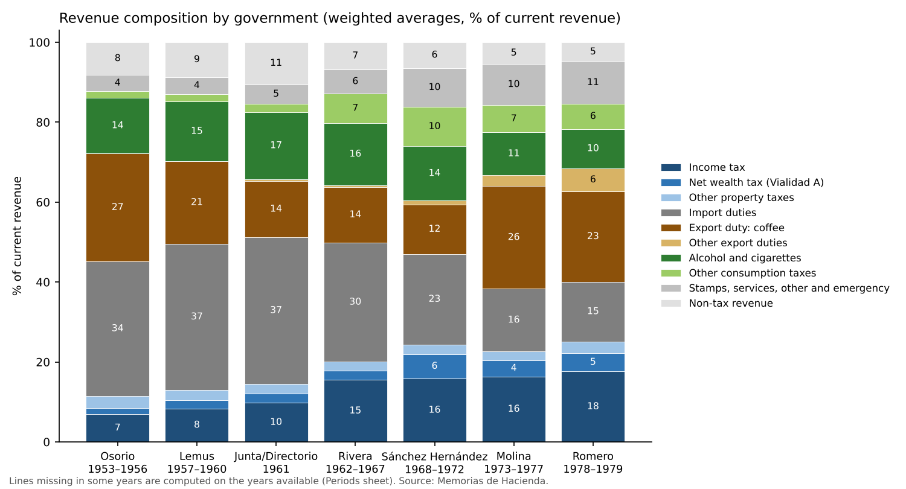
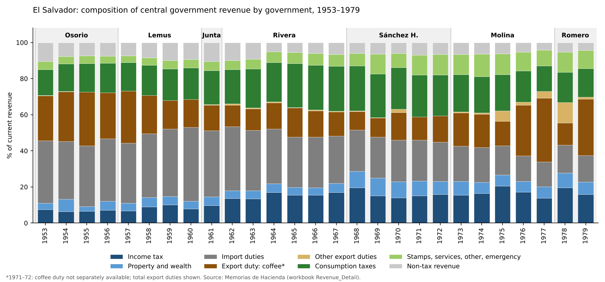
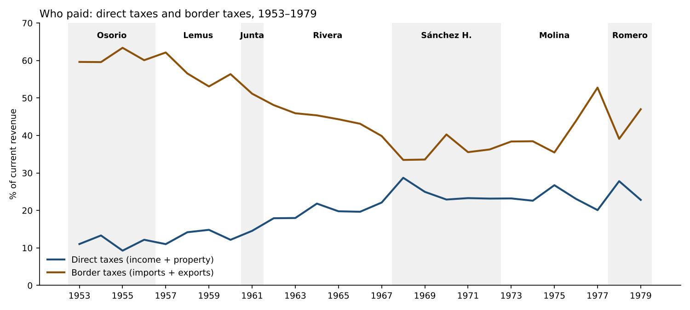

# The Revenue Series from the Memorias, 1952–1979: Design, First Findings and Next Steps

**Working note for discussion — November 2026 (updated 11 November 2026 with the detailed series).** Companion to the workbook *El_Salvador_Revenue_Memorias_1952_1979.xlsx*. It records the discussion so far on charts, periodization and disaggregation, what the detailed series shows, and the decisions pending.

---

## 1. What the workbook contains now

- One row per year, 1952–1979, in millions of colones at current prices.
- All figures come from the Memorias de Hacienda as verified in the yearly notes, and are mapped into one modern classification:
  - income tax (personal, corporate, other);
  - property and wealth;
  - import duties;
  - export duties (coffee, other);
  - consumption of goods;
  - services, stamps and other taxes;
  - the 1969–70 emergency tax;
  - non-tax revenue.
- From 1953, the categories add up to the printed tax and current-revenue totals in every year, within ±0.02.
- **Limits:**
  - 1952 has totals only (old classification, customs not split);
  - in 1970, "services, stamps and other" is a residual;
  - in 1971–72, the coffee duty and the personal/corporate split are not available;
  - there is no annual coffee price before 1960;
  - real values can be computed only from 1974.

**New sheets (11 November 2026).**

- **Revenue_Detail:** about 30 lines inside the same groups (section 4). Every group has a "not itemized" column, so each group ties to Revenue_CM and the tax total ties to the printed total in every year.
- **Periods:** composition by government, weighted averages, with a stacked-bar chart.
- **Charts_Detail:** the four recommended charts of section 2, plus consumption and property taxes over time.
- **Charts_Shaded:** the annual composition with each government shaded, and the period bars (images).
- **Tax_Laws:** five new items (the 1953 Ley de Vialidad; the cotton tax; the cosmetics tax; the selective consumption tax; the 1977 doubling of the net wealth tax).

**Conventions adopted (11 November 2026).**

- "Corporate income tax" (*renta de empresas*), not "company tax".
- The 1950s *Títulos* and subclasses are mapped into the modern categories, with the mapping explained in the workbook.

---

## 2. Recommended additional charts

**From the data already in the workbook**

1. **Direct taxes against export and import duties, as shares of revenue (1953–79).** It shows the "who paid" question directly: a State financed at the border, with direct taxes rising mainly in busts (1962, 1975, 1978).
2. **Corporate income tax as a share of the coffee duty (1964–79).** It swings from about 61% in busts to 13% in booms: how lightly capital was taxed relative to coffee.
3. **Revenue growth against the change in the coffee price (1960–79).** Paired bars showing revenue sensitivity to coffee, and the years when volume rather than price drove the duty (1975, 1978–79).
4. **Change in each revenue source in boom and bust years** (1976–77 against 1978). It shows that the coffee duty carries the cycle while the other taxes barely move.

**Needing one more series**

5. **Tax revenue as a share of GDP, 1952–79, with markers for major tax laws.** It needs GDP before 1968 (CEPAL, *Estudio Económico de América Latina*).
6. **Real revenue per person.** It needs a price index before 1974 and population (DIGESTYC; censuses).

**With the expenditure workbook**

- Coffee duty against security and development spending.

---

## 3. Periodization by government

### 3.1 The proposal

The author proposes reading the evolution of the tax system by period:

- **1948–1960:** the modernization begun by Osorio.
- **1960–1967:** the opening and rapid growth of the Rivera years, driven by the Common Market, with coffee prices lower and more stable than in the 1970s.
- **The Molina and Romero periods.**

This note suggests one addition: the **Sánchez Hernández period (1967–1972)** as a period of its own. It is where the turn happens:

- the 1969 war and the end of the Common Market's dynamism;
- the education reform and the ANDES strikes of 1968 and 1971;
- the 1972 electoral fraud.

It also has a distinct tax signature: the 1969 emergency tax, and property taxes doubling after the 1968 increase in the net wealth tax.

### 3.2 Results by government

Shares of current revenue, weighted by revenue (period sum of each source over period sum of current revenue). Years are assigned to the president inaugurated the previous July (e.g. 1962 to Rivera).

| % of current revenue | Osorio 1953–56 | Lemus 1957–60 | Junta 1961 | Rivera 1962–67 | Sánchez H. 1968–72 | Molina 1973–77 | Romero 1978–79 |
|:--|--:|--:|--:|--:|--:|--:|--:|
| Income tax | 6.9 | 8.4 | 9.7 | 15.5 | 15.8 | 16.4 | 17.6 |
| — personal | n.a. | n.a. | n.a. | 8.8* | 9.7* | 7.6 | 8.4 |
| — corporate | n.a. | n.a. | n.a. | 5.3* | 4.4* | 6.0 | 6.7 |
| Net wealth tax (Vialidad A) | 1.5 | 2.1 | 2.3 | 2.3 | 6.1* | 4.1 | 4.7 |
| Other property taxes | 3.1 | 2.5 | 2.5 | 2.2 | 2.4* | 2.2 | 2.8 |
| Import duties | 33.7 | 36.6 | 36.6 | 29.9 | 22.6 | 15.7 | 15.0 |
| Export duty: coffee | 27.0 | 20.6 | 14.1 | 13.8 | 12.4* | 25.6 | 22.6 |
| Other export duties | 0.0 | 0.0 | 0.4 | 0.5 | 0.9* | 2.8 | 5.8 |
| Alcohol and cigarettes | 13.9* | 15.0 | 16.8 | 15.5 | 13.6* | 10.7 | 9.8 |
| Other consumption taxes | 1.7* | 1.8 | 2.0 | 7.4 | 9.8* | 6.8 | 6.4 |
| — of which petroleum products | – | – | – | 4.9* | 6.9* | 3.5 | 3.0 |
| Stamps, services, other, emergency | 4.1 | 4.3 | 4.9 | 6.0 | 9.8 | 10.4 | 10.6 |
| Non-tax revenue | 8.2 | 8.7 | 10.5 | 6.8 | 6.4 | 5.4 | 4.8 |
| **Memo:** direct taxes | 11.5 | 12.9 | 14.6 | 20.0 | 24.4 | 22.6 | 25.1 |
| **Memo:** border taxes (imports + exports) | 60.7 | 57.3 | 51.1 | 44.2 | 36.0 | 44.1 | 43.4 |
| Revenue growth per year | 7.1% | 0.0% | −7.3% | 6.2% | 7.5% | 29.3% | 1.4% |
| Coffee price (US$/kg) | n.a. | 0.92 (1960) | 0.90 | 0.91 | 1.00 | 2.52 | 3.71 |

\*Split within the group missing in some years; the group's share is for the whole period and is divided using the years available (personal/corporate from 1964, not 1971–72; coffee not 1971–72; alcohol and cigarettes from 1954; property detail not 1971–72; petroleum from 1963).

{width=6.5in}

{width=6.5in}

### 3.3 What the table suggests

- **The 1960s changed the tax base.** Under Rivera the share of direct taxes nearly doubled (12% to 20%) after the 1961 and 1963 income-tax laws, coffee's share halved (about 27% to 14%), and consumption taxes rose to 23%. On the revenue side this was the most diversified period of the series.
- **The Common Market eroded import duties:** from 37% of revenue under Lemus to 23% under Sánchez Hernández and 15% in the 1970s, through regional free trade and industrial exemptions.
- **The 1970s coffee boom reversed the 1960s.** Under Molina and Romero, coffee's share returned to the Osorio level (23–26%), while direct taxes stayed around 23–25%. The State went back to riding coffee.
- **Coffee prices confirm the author's recollection.** They were low and stable in 1960–67 (US$0.81–1.01/kg), supported from 1963 by the International Coffee Agreement. They were US$1.37–1.45 in 1973–75 and US$3.15–5.17 in 1976–77. Revenue growth in the Rivera years came from income and consumption taxes, not from coffee.

### 3.4 Charts for the periodization

- A 100%-stacked bar of revenue composition, **one bar per government**.
- The annual composition chart with **each government shaded as a band**, so that within-period swings (1958–59, 1978) stay visible.
- A summary table of period averages with growth and the coffee price.

### 3.5 Decisions pending (the workbook uses the first option in each case)

1. Treat Sánchez Hernández as a separate period? Keep the 1961 Junta/Directorio year apart or join it to Rivera?
2. **Transition years.** Presidents took office on 1 July, but each year's budget was enacted the previous December by the outgoing government. Options:
   - the year after inauguration goes to the new president (used above);
   - split those years, or mark them as transition years.
3. Weighted averages (used) or simple averages of annual shares?
4. A 1948 benchmark bar from Pleitez? He gives export taxes at 14.3% of tax revenue in 1948 (29.8% on average in 1951–57) and income tax at 5.7% in 1948. Our Memorias start in 1953.

---

## 4. Disaggregation: the proposed detail

The broad categories hide the distinctions the argument needs. The proposed structure has about 25 lines.

### 4.1 Income tax

**Lines:** personal, corporate, other income.

- **1964–1979:** the split is available, except 1971–72 (statements missing from the scans).
- **1953–1963:** the Memorias give only the total; the split would have to come from the Dirección General de Contribuciones Directas. The income tax law of December 1963 (D. 479) introduced the separate reporting.
- **Fines** are included in 1964–68 and excluded from 1969. From 1975 the statements show income-tax fines separately, as non-tax revenue.

### 4.2 Property and wealth: what Vialidad is

**Vialidad Serie "A" is a net wealth tax.**

- It was created by the Ley de Vialidad, D.L. 1308 of 22 December 1953 (Diario Oficial No. 233, Tomo 161).
- The law that replaced it in 1986 (Ley del Impuesto sobre el Patrimonio, D.L. 553 of 18 December 1986) states that the tax "recae sobre el capital o patrimonio de los sujetos pasivos" and that its rates were "mínimas".
- The 1975–79 statements call it "Impuesto sobre el Capital (Vialidad Serie 'A')".

**Proposed name:** "Net wealth tax (Vialidad Serie A)". Its jump in 1968 (₡5.7M to ₡15.4M) is then a wealth-tax increase, which matters for the tax-bargain argument.

**Proposed lines:**

- net wealth tax (Vialidad A);
- property-transfer tax (*alcabala*; under "other taxes" in the 1950s);
- succession tax;
- gift tax;
- agricultural land tax (1978–79);
- paving levy.

### 4.3 Exports: coffee, sugar, shrimp and cotton

**Lines:** coffee, sugar, shrimp, cotton (if any), other merchandise.

- **Coffee** dominates throughout.
- **Shrimp:** taxed from 1961 (D. 154).
- **Sugar:** a progressive export tax from November 1974 (D.L. 135), yielding ₡25.6M in 1975 and falling to almost nothing by 1978.
- **"Other merchandise"** reached ₡116.6M in 1978 and fell back to ₡12.5M in 1979; its legal basis is still to be identified.
- **Cotton is the notable case.** It reached about 15% of exports by 1960 (Acevedo, 2003), but the Memorias show no cotton export duty. The only trace is a small tax "Sobre el Algodón" recorded under consumption taxes: ₡0.29M (1956), ₡0.35M (1957), ₡0.03M (1958), then nothing. The second export crop of the 1950s appears to have been almost untaxed at the border. **To verify in the Diario Oficial**, and in the 1960s–70s statements, where a cotton levy could sit in "other merchandise".

### 4.4 Consumption taxes: how they evolve

- **1950s:** alcohol (liquor and beer), cigarettes, sugar for domestic consumption, soft drinks; cotton (1956–58).
- **1963:** new taxes on petroleum products refined in the country and on flour. Petroleum became the second consumption tax by the late 1960s.
- **1975–79:** the statements add a **selective consumption tax** (*Impuesto Selectivo al Consumo*, ₡9.2M in 1975, ₡22.7M in 1977) and a tax on matches (introduced in 1959).

**Proposed lines:** alcohol; cigarettes; petroleum products; sugar; beverages; selective consumption tax; flour, matches and other.

### 4.5 Stamps and services

- **Stamp duties** (*timbres fiscales* and sealed paper) are separated. They are the largest piece of this group: ₡87.8M of stamps in 1979, and they doubled in 1971.
- **Services and other taxes:**
  - taxes on the use of services (vehicle registration, air and sea passages, insurance premiums, public shows);
  - business licences and levies;
  - other taxes (migration, etc.).

### 4.6 Where the detail is (as built)

| Years | Itemized lines | Source |
|:--|:--|:--|
| 1953 | Net wealth tax, successions and gifts | MH 1954 comparatives |
| 1954–1955 | Also alcohol and cigarettes (1955: sugar and beverages) | MH 1954, MH 1955–56 |
| 1956–1963 | All lines except the income-tax split | Item detail, checked against subclass totals |
| 1964–1969 | All lines | Estado II-5 in MH 1964–1970, cross-checked across the three-year statements |
| 1970 | Net wealth tax, successions and gifts, shrimp, alcohol, stamps | Memoria groupings |
| 1971–1972 | Stamp duties only | MH 1972 Cuadro 10 |
| 1973 | All lines | MH 1973 Estado I-4 (page image) |
| 1974–1979 | All lines | MH 1978 and MH 1979, Estado II-1 |

Two corrections were found while checking the 1975–79 detail against the printed subtotal: 1977 alcohol is ₡73.28M (not ₡75.28M) and 1979 sugar is ₡2.77M. Neither changes any group total or any figure in the yearly notes.

---

## 5. What the detailed series shows

1. **The 1960s reform was a turn to consumption and income, not to wealth.** Under Rivera, income tax rose from 8–10% to 15.5% of revenue and the new petroleum and flour taxes (1963) added about 5 points. The net wealth tax stayed at about 2%: the base the elite held in land and capital was barely touched.
2. **The wealth tax moved twice.** Its share tripled under Sánchez Hernández (₡5.7M in 1967 to ₡15.4M in 1968, before the war) and its yield doubled again in 1977 (₡25.9M to ₡54.0M), at the peak of the coffee boom. The 1977 increase is not yet explained; it is now in the Diario Oficial checklist.
3. **Corporate income tax never passed 7% of revenue.** Personal income tax was larger in every period with data. Corporate income tax was 13–61% of the coffee duty (Charts_Detail).
4. **Alcohol and cigarettes carried a sixth of the budget until the late 1960s** (14–17% of revenue), falling to about 10% in the 1970s. Until 1961 these two excises yielded more than all direct taxes together.
5. **Cotton was not taxed at the border.** The only trace is a small tax "Sobre el Algodón" in 1956–58 (₡0.29M at most). The 1975 sugar export tax (₡25.6M) was the only other agro-export levy of weight, and it yielded mainly in that one year (₡3.3M in 1976).
6. **"Other merchandise" export duties are the puzzle of 1977–78** (₡41.9M and ₡116.6M, 5.8% of revenue under Romero). Their legal basis is still to be identified.
7. **Stamps grew into a mass tax.** Stamp duties rose from ₡2.8M (1.6% of revenue) in 1956 to ₡87.8M (7.2%) in 1979; they doubled in 1971.
8. **The agricultural land tax yielded ₡10.1M in 1978 and ₡7.7M in 1979**, about 1% of revenue: the only tax on land of the period, decreed in December 1977, a year after the 1976 agrarian transformation was withdrawn.

{width=6.5in}

---

## 6. Next steps

1. **Fill the remaining gaps:** 1953–55 consumption and stamps (Memorias 1953–55, Estado 2); 1970–72 detail (MH 1971 and 1972 statements, if other scans exist); the income-tax split before 1964 (Dirección General de Contribuciones Directas).
2. **Decide the pending period choices** (section 3.5).
3. **Expenditure workbook** on the same design, then the financing and execution of infrastructure.
4. Diario Oficial checklist (Tax_Laws sheet), now including:
   - the base and rates of the net wealth tax;
   - any cotton levy;
   - the selective consumption tax;
   - the "other merchandise" export duty;
   - the 1977 increase in the net wealth tax.

---

*Sources: Memorias de Hacienda 1952–1979 (Estados 2, II-5, I-4 and II-1) via the yearly notes and the revenue workbook; MH 1979, part B, Estado II-1 (1975–1979); item-level revenue file 1952–1964 (co-authored dataset); Ley del Impuesto sobre el Patrimonio, D.L. 553 (1986), recitals (https://www.jurisprudencia.gob.sv/DocumentosBoveda/D/2/1980-1989/1986/12/888FB.PDF); Pleitez, chapter 2; Acevedo (2003), IDB; World Bank Pink Sheet.*
